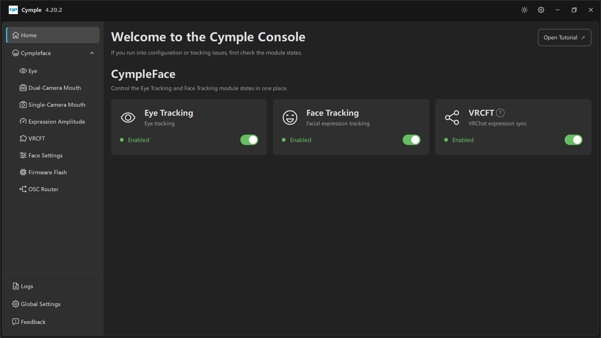
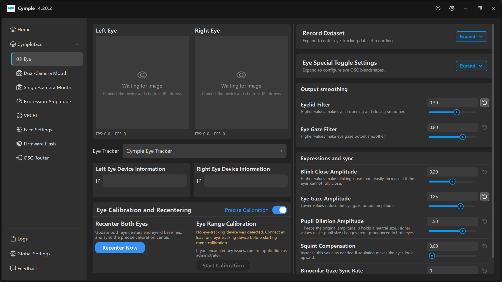
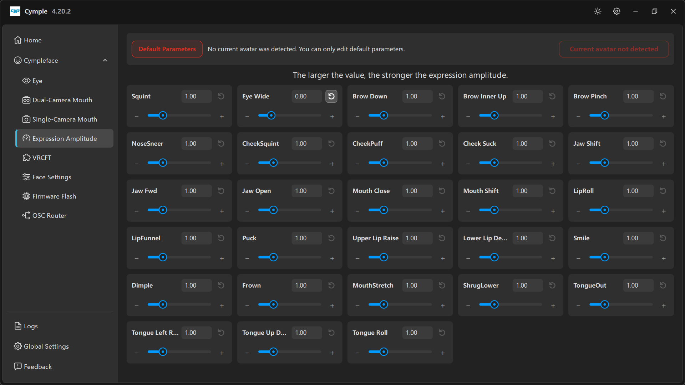

# Quick start

This is the shortest path that ends with your avatar blinking and looking around. It assumes the
hardware is already assembled and powered — if not, start with [Hardware](../hardware/index.md).

## Step 1 — Power and join the network

1. Power the tracker (USB battery or the headset's USB port).
2. The camera module boots into Wi-Fi station mode with the credentials you flashed into it. Default
   builds join the SSID stored in the device config; see [Network setup](../hardware/network.md) to
   change it.
3. Note the device IP. It is printed by the device's serial output and, once the console connects,
   shown in the **IP** fields.

## Step 2 — Open the console and enable modules

On [Home](../software/home.md), verify the three switches:

- **Eye Tracking** — on
- **Face Tracking** — on (even for eye-only setups, the face solver also produces eyelid data)
- **VRCFT** — on if you want VRC Direct output

Each card shows a green **Enabled** pill when the subsystem is running.

## Step 3 — Enter the device IPs

1. Open **Cympleface → Eye**.
2. Set **Eye Tracker** to `Cymple Eye Tracker`.
3. Type the left camera IP into **Left Eye Device Information → IP**, the right one into
   **Right Eye Device Information → IP**.
4. Wait for the previews. `FPS` and `PPS` at the bottom-left of each preview must be non-zero;
   a healthy DIY eye camera sits around 25–30 FPS on 5 GHz.

If you only have a mouth tracker, do the same on
[Dual-Camera Mouth](../software/dual-camera-mouth.md) or
[Single-Camera Mouth](../software/single-camera-mouth.md) → **Device Info → IP**.

## Step 4 — Calibrate

1. Look straight ahead, then press **Recenter Now** under **Recenter Both Eyes**.
2. Look at each of the nine dots in **Eye Range Calibration** and press **Start Calibration**.
   If the button is greyed out, the console has not detected a device yet — fix Step 3 first.
3. Optional: enable **Precise Calibration** for a slower, more accurate solve.

Full detail: [Calibration](../guides/calibration.md).

## Step 5 — Choose the output path

**Direct (simplest)**

1. [VRCFT](../software/vrcft.md) → **VRC Direct** on.
2. Confirm **Receive 9001**, **IP 127.0.0.1**, **Send 9000**.
3. In VRChat enable OSC (**Options → OSC → Enabled**).
4. Status should read **VRC Direct Running** with a non-zero **Output Rate**.

**External VRCFT**

1. Turn **VRC Direct** off.
2. Start VRCFaceTracking with the Cymple module installed.
3. Add the module's parameters to your avatar — see [VRChat setup](../guides/vrchat-setup.md).

## Step 6 — Trim the expressions

Open **Expression Amplitude**. The red banner *"No current avatar was detected"* means the console
is editing **default parameters** — that is fine until VRChat reports an avatar.

Start with everything at `1.00`, then adjust only what looks wrong:

| Symptom | Control |
|---|---|
| Eyes close too much / too little | **Blink Close Amplitude** on [Eye](../software/eye.md) |
| Gaze too twitchy | **Eye Gaze Filter**, raise toward `0.9` |
| Gaze too weak | **Eye Gaze Amplitude**, raise toward `1.0` |
| Squinting looks wrong | **Squint Compensation** |
| Mouth shapes too strong | The matching slider here, lower to `0.7`–`0.8` |

## Step 7 — Save and verify

- Mouth pages require an explicit **Save and apply** only in [OSC Router](../software/osc-router.md);
  everything else applies immediately.
- Keep the console on [Logs](../software/logs.md) while you test. A working pipeline logs the device
  connection once and then stays quiet.

## Checklist

- [ ] Both eye previews show a live image
- [ ] `FPS` > 20, `PPS` > 20
- [ ] Recenter performed after putting the headset on
- [ ] Range calibration completed
- [ ] Output rate non-zero during VRChat
- [ ] Avatar blinks when you blink

---

**Next:** [Calibration](../guides/calibration.md) · [VRChat setup](../guides/vrchat-setup.md)

[Русская версия](../../ru/getting-started/quick-start.md) · English
