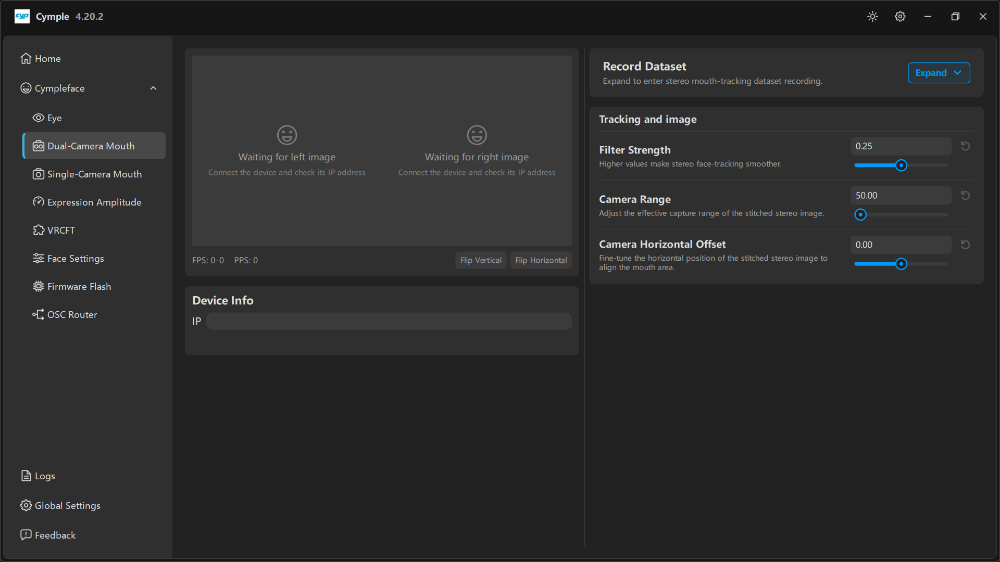

# Dual-camera mouth tracker

Two cameras aimed at the lower face. The stereo pair gives the solver depth, which is what separates
a convincing jaw from a flat one — and what makes `Jaw Fwd`, `Jaw Shift` and `CheekPuff` usable.

## Parts

| Part | Notes |
|---|---|
| 2 × ESP32 camera module | Mounted side by side, fixed baseline |
| Printed shell | `模型/面捕/` — `双目面捕` (stereo) variant |
| Diffuser or matte panel | Optional; kills hot spots from a desk lamp or window |
| Power | USB 5 V, shared with the eye tracker if you have one |
| Fasteners | M2×6 self-tapping screws |

## Build

1. **Print** the stereo shell and the under-headset arm for your headset.
2. **Flash** both boards with the mouth profile (see [Firmware](firmware.md)).
3. **Seat** the cameras with the **same baseline** you intend to keep. Once glued or screwed, do not
   move them independently — the stitching calibration assumes a fixed geometry.
4. **Mount** the arm so both cameras see the mouth, chin and cheeks. The nose is a useful reference:
   if the nose tip is cut off at the top of the frame, tilt the arm up slightly.
5. **Protect** the pair from flex. A loose arm means a drifting stitch, which shows up as a mouth
   that slowly slides sideways during a session.

## Connect

1. Open [Dual-Camera Mouth](../software/dual-camera-mouth.md).
2. Enter the camera IP in **Device Info → IP**.
3. Both previews must show a live image; `FPS`/`PPS` at the bottom must move.
4. Use **Flip Vertical** / **Flip Horizontal** to make the image orientation match reality — these
   buttons change how the console interprets the frame, so apply them *before* tuning.

## Align the stitch

The console stitches the two images into one mouth view. Three controls matter:

| Control | What it does | How to set it |
|---|---|---|
| **Camera Range** | Effective capture range of the stitched image | Lower it if the mouth looks too small; raise it if the chin or cheeks are cropped |
| **Camera Horizontal Offset** | Shifts the stitch horizontally | Move until the mouth is centred and both halves line up at the seam |
| **Filter Strength** | Temporal smoothing of the mouth data | `0.25` default; raise for a shaky mount, lower for snappier lips |

A correct stitch looks like one continuous face: no visible seam down the middle, the mouth centred,
and the jaw line continuous across the boundary.

## Tracking tips

- **Keep the mouth in frame** at maximum smile and maximum jaw drop. Test both extremes before you
  close the shell.
- **Even light.** A window behind you creates a silhouette and the lip detector loses the boundary.
- **No beard-length changes mid-calibration.** Facial hair alters the lip edge; recalibrate after a
  trim.
- If `Mouth Close` is always slightly on, your **Camera Range** is probably too wide and the lips are
  a few pixels tall. Narrow the range.

## Dataset recording

If you want to fine-tune the solver on your own face, the **Record Dataset** panel on the same page
captures labelled frames. See [Dataset recording](../guides/dataset-recording.md).

---

**Next:** [Single-camera mouth tracker](single-camera-mouth.md) · [Network setup](network.md)

[Русская версия](../../ru/hardware/dual-camera-mouth.md) · English
