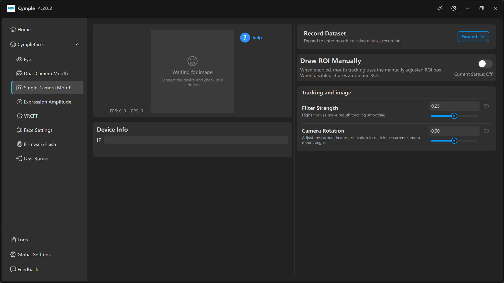

# Single-camera mouth tracker

One camera, one IP, one image. Cheaper and lighter than the stereo pair, with slightly softer depth
cues: `Jaw Fwd` and `CheekPuff` are less authoritative, while lips, brow and tongue track fine.

## Parts

| Part | Notes |
|---|---|
| 1 × ESP32 camera module | Any board that fits the `单目面捕` shell |
| Printed shell | `模型/面捕/` — mono variant, plus the under-headset arm |
| Power | USB 5 V |
| Fasteners | M2×6 self-tapping screws |

## Build

1. **Print** the mono shell and arm.
2. **Flash** the mouth firmware before closing the shell ([Firmware](firmware.md)).
3. **Seat** the camera so the mouth sits in the lower third of the frame, with the nose bridge just
   visible at the top — that framing gives the solver a stable vertical reference.
4. **Mount** the arm at a comfortable angle. Aim for the camera to look slightly *up* at the mouth:
   a downward angle hides the upper lip behind the nose.
5. **Check reach**: the camera must still see the mouth when you smile widely.

## Connect

1. Open [Single-Camera Mouth](../software/single-camera-mouth.md).
2. Enter the IP in **Device Info → IP**.
3. Wait for the preview and a non-zero `FPS`.
4. Use **Camera Rotation** to level the image if the arm is mounted at an angle.

## Manual ROI (region of interest)

By default the console finds the mouth automatically. If your framing is unusual — a very close
camera, an unusual headset, a partial beard — you can pin the region instead:

1. Turn on **Draw ROI Manually**. The status line changes from **Current Status: Off** to *On*.
2. Draw the box around the mouth area in the preview.
3. Keep the box tight but not clipped: the corners of the mouth must stay inside it at maximum smile.
4. Turn it back off to return to automatic ROI. If automatic tracking is fine, leave this off — the
   manual box cannot follow headset slippage.

## Tuning

| Control | Effect |
|---|---|
| **Filter Strength** | Smoothing; `0.25` is a good start. Raise on a shaky mount |
| **Camera Rotation** | Rotates the capture to level the face; set it once, then leave it |

Because there is no stereo baseline, prefer tuning through
[Expression Amplitude](../software/expression-amplitude.md) rather than pushing the camera:

- `Jaw Open` too strong → lower to `0.8`.
- `Mouth Close` weak → raise slightly, but check that your lips are not clipped by the frame first.
- `CheekPuff` barely moves → expected on mono; compensate in the avatar if it matters.

## When to upgrade to stereo

Choose the dual-camera build if you need:

- believable `Jaw Fwd` / `Jaw Shift`,
- `CheekPuff` and `Cheek Suck` that respond to actual volume change,
- stable tracking when the headset shifts slightly.

---

**Next:** [Network setup](network.md) · [Firmware](firmware.md)

[Русская версия](../../ru/hardware/single-camera-mouth.md) · English
