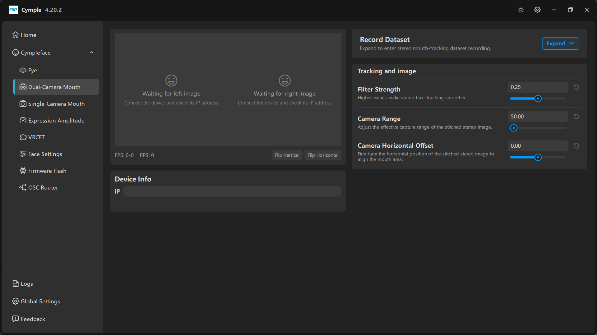

# Dual-Camera Mouth

The stereo mouth tracker page. Left column is device input and previews; the right column is
recording and the three image/tracking controls that decide whether the expression solver has
anything good to work with.

## Layout

| Column | Contains |
|---|---|
| Left | **Left/Right image** previews, **FPS**/**PPS**, **Flip Vertical** / **Flip Horizontal**, **Device Info** |
| Right | **Record Dataset**, **Tracking and image** |

## Previews

Both halves of the stereo pair are shown. A dashed placeholder with *"Waiting for left image"* /
*"Waiting for right image"* and *"Connect the device and check its IP address"* means the console has
no stream.

| Counter | Meaning |
|---|---|
| **FPS** | Frames per second from the pair |
| **PPS** | Processed samples per second |

## Flip Vertical / Flip Horizontal

Two toggle buttons under the previews. They correct for a shell that was mounted upside-down or
mirrored — common when the camera ribbon cable can only reach one way.

> Apply flips **before** touching **Camera Range** or **Camera Horizontal Offset**. Flipping after
> tuning invalidates the offsets and you will re-tune twice.

If the image is rotated 90° rather than flipped, you mounted the shell at a right angle; fix it
physically, there is no rotation control on this page.

## Device Info

A single **IP** field: the stereo pair is addressed as one device. Enter the IP of the pair's
streaming interface.

## Record Dataset

*"Expand to enter stereo mouth-tracking dataset recording."*

Collapsed by default. Expanded, it records labelled stereo frames for retraining or fine-tuning.
See [Dataset recording](../guides/dataset-recording.md).

## Tracking and image

| Parameter | Default | Tooltip | Practical range |
|---|---|---|---|
| **Filter Strength** | `0.25` | *"Higher values make stereo face-tracking smoother."* | `0.15` snappy · `0.4` smooth |
| **Camera Range** | `50.00` | *"Adjust the effective capture range of the stitched stereo image."* | `35`–`70` |
| **Camera Horizontal Offset** | `0.00` | *"Fine-tune the horizontal position of the stitched stereo image to align the mouth area."* | `-15`–`+15` |

### Tuning order

1. **Camera Range** first — frame the face correctly. Too wide and the lips are a few pixels tall;
   too narrow and the chin is cut off.
2. **Camera Horizontal Offset** second — centre the mouth and hide the stitch seam.
3. **Filter Strength** last — it changes how the result feels, not what it measures.

### Symptoms and causes

| Symptom | Likely cause |
|---|---|
| `Mouth Close` never reaches 0 | Range too wide, lips too small in frame |
| Mouth drifts sideways during a session | Loose mount, or offset tuned while the arm was flexed |
| Visible seam down the middle | Horizontal offset off; re-centre it |
| Expressions lag ~200 ms | **Filter Strength** too high |
| Expressions twitch between frames | **Filter Strength** too low, or uneven lighting |

## Light and framing

- Keep the nose tip in frame — the solver uses it as a vertical anchor.
- Avoid a window directly behind the head; silhouette lighting kills the lip edge.
- Test the widest smile and the deepest jaw drop before closing the shell. If either clips, adjust
  the arm angle, not the range.

---

**Next:** [Single-Camera Mouth](single-camera-mouth.md) · [Expression Amplitude](expression-amplitude.md)

[Русская версия](../../ru/software/dual-camera-mouth.md) · English
