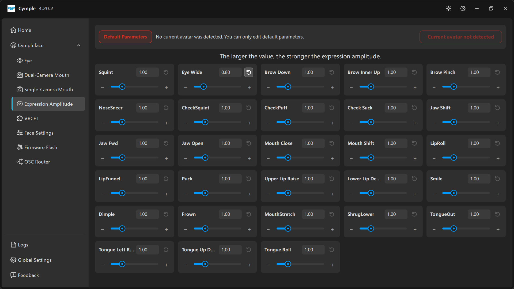

# Expression Amplitude

A grid of 28 sliders — one gain per expression. It is the page people spend the most time on, and the
one most likely to be misunderstood: it **does not change tracking**, it changes the amplitude the
solver reports.

## The banner

At the top: **Default Parameters** (red outline) plus the note

> *"No current avatar was detected. You can only edit default parameters."*

and, on the right, a red pill: **Current avatar not detected**.

Reading:

| State | Meaning |
|---|---|
| Red pill, **Default Parameters** active | VRChat has not told the console which avatar is loaded. Edits go to the fallback profile applied to any avatar |
| No red pill | VRChat reported an avatar; the console now edits that avatar's profile |

The avatar is detected through OSC from VRChat. If the pill never clears: enable OSC in VRChat, keep
**VRC Direct** on, and check **Input Rate** on [VRCFT](vrcft.md). A missing avatar is a VRChat→console
problem, not a tracker problem.

Why the split matters: parameters follow the avatar. A chibi avatar with big eyes usually wants a
different **Eye Wide** gain than a realistic one. Editing defaults while an avatar *is* loaded has no
effect on that avatar.

## Header

> *"The larger the value, the stronger the expression amplitude."*

Every slider is `1.00` by default, adjustable from `0` (expression suppressed) upward. Each card has:

| Element | Function |
|---|---|
| Value box | Type an exact value; arrows nudge it |
| ⟲ button | Reset that expression to `1.00` |
| **−** / **+** | Coarse adjustment |
| Slider | Drag for fast, non-linear hunting |

## The 28 expressions

Listed in the console's grid order:

| Row | Expressions |
|---|---|
| 1 | **Squint**, **Eye Wide**, **Brow Down**, **Brow Inner Up**, **Brow Pinch** |
| 2 | **NoseSneer**, **CheekSquint**, **CheekPuff**, **Cheek Suck**, **Jaw Shift** |
| 3 | **Jaw Fwd**, **Jaw Open**, **Mouth Close**, **Mouth Shift**, **LipRoll** |
| 4 | **LipFunnel**, **Puck**, **Upper Lip Raise**, **Lower Lip De…** (depress), **Smile** |
| 5 | **Dimple**, **Frown**, **MouthStretch**, **ShrugLower**, **TongueOut** |
| 6 | **Tongue Left R…** (roll), **Tongue Up D…**, **Tongue Roll** |

Names are per-avatar blendshapes in VRChat. Your avatar must expose the same parameter names, or the
value is simply dropped — see [VRChat setup](../guides/vrchat-setup.md).

## A tuning method that converges

Do not tune 28 sliders by feel. Use this loop per expression:

1. **Set everything else to `1.00`.** A clean baseline makes one variable at a time meaningful.
2. **Trigger the expression hard** — full smile, full squint, tongue out.
3. **Compare with reality** in a mirror or a VRChat camera.
4. **Adjust the one slider**, then repeat the trigger three times to check consistency.
5. **Check the resting face.** Many avatars end up with permanent squint because `Squint` was raised
   to compensate for a weak tracker.

Signs a value is too high: expressions snap to maximum, the face looks exaggerated, and adjacent
shapes bleed (e.g. `Smile` dragging `CheekSquint`).

## Per-expression guidance

| Expression | Raise when | Watch out for |
|---|---|---|
| **Squint** | Squinting barely shows | Permanent squint at rest |
| **Eye Wide** | Surprise reads flat | Eyes clipping through lids |
| **Brow Down / Inner Up / Pinch** | Brows look frozen | Brow jitter, eyelid interaction |
| **NoseSneer** | Disgust is invisible (common) | Unrelated nose motion |
| **CheekSquint / CheekPuff / Cheek Suck** | Cheeks do not react | Mono builds: weak signal, do not overcorrect |
| **Jaw Fwd / Jaw Shift** | Chewing, jaw angle | Strong on stereo, weak on mono |
| **Jaw Open** | Mouth barely opens | Over-opening, chin clipping |
| **Mouth Close** | Lips stay parted | Fighting **Jaw Open** |
| **Mouth Shift** | Asymmetric mouth | Drift |
| **LipRoll** | Roll is invisible | — |
| **LipFunnel / Puck** | Kiss/whistle shapes weak | Cross-talk between the two |
| **Upper Lip Raise / Lower Lip Depress** | Snarl/teeth | Gum reveal exaggeration |
| **Smile / Dimple / Frown** | Emotion reads flat | Smile bleeding into cheeks |
| **MouthStretch / ShrugLower** | Tension shapes missing | — |
| **TongueOut / Tongue Left / Tongue Up / Tongue Roll** | Tongue invisible | Detection is noisy; go gently |

## Interaction with the Eye page

Two gains for the same effect exist on purpose:

- **Blink Close Amplitude** on [Eye](eye.md) controls how easily the *eyelids* close.
- **Squint** here controls the *expression*, not the lid.

If eyes will not close, fix [Eye](eye.md) → **Blink Close Amplitude** first; raising `Squint` here
will not help and will distort the face.

## Saving

Changes apply immediately and persist to `%LOCALAPPDATA%\Cymple\iniFile.ini`. There is no save button;
there is also no undo, so note the old value before a big change (the ⟲ reset is per slider).

---

**Next:** [VRCFT](vrcft.md) · [VRChat setup](../guides/vrchat-setup.md)

[Русская версия](../../ru/software/expression-amplitude.md) · English
