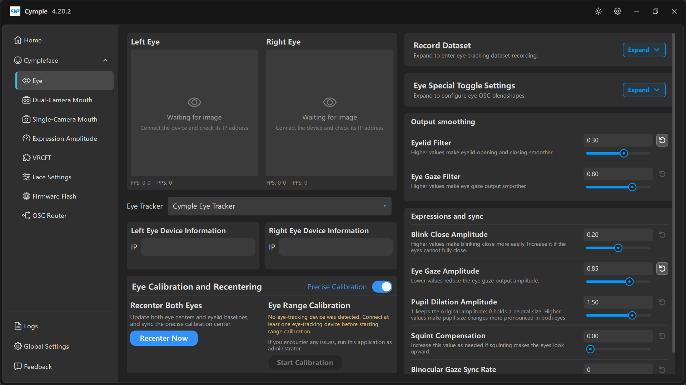

# Eye

The densest page in the console: device input on the left, calibration in the middle, and every
gaze-related output parameter on the right.

## Layout

| Column | Contains |
|---|---|
| Left | **Left Eye** / **Right Eye** previews, **FPS** / **PPS** counters |
| Middle | **Eye Tracker** selector, **Left/Right Eye Device Information**, **Eye Calibration and Recentering** |
| Right | **Record Dataset**, **Eye Special Toggle Settings**, **Output smoothing**, **Expressions and sync** |

## Camera previews

Each card shows a live image, or a dashed placeholder with *"Waiting for image"* and
*"Connect the device and check its IP address"*.

| Counter | Meaning | Healthy value |
|---|---|---|
| **FPS** | Frames per second received from that camera | 25–30 on 5 GHz |
| **PPS** | Processed samples per second — frames the solver actually accepted | Close to FPS |

**FPS high, PPS low** means the frames arrive but the pupil detector rejects them: aim, focus or
lighting. **Both zero** means a network problem — go to [Network setup](../hardware/network.md).

## Eye Tracker

Dropdown selecting the tracking backend. `Cymple Eye Tracker` is the native two-camera driver. Other
entries appear when additional backends are installed; leave the default unless you are deliberately
mixing hardware.

## Device information

Two text fields, one per eye:

| Field | Input |
|---|---|
| **Left Eye Device Information → IP** | IP of the left camera, e.g. `192.168.1.201` |
| **Right Eye Device Information → IP** | IP of the right camera, e.g. `192.168.1.202` |

Both are required for binocular tracking. With only one camera the console runs monocular — gaze is
usable, depth cues and pupil symmetry are not.

## Eye Calibration and Recentering

### Precise Calibration

A toggle at the top-right of the panel. On, the calibration solve takes longer and lands a more
accurate centre. Recommended once your mount is final; turn it off while you are still moving the
cameras around.

### Recenter Both Eyes

> *"Update both eye centers and eyelid baselines, and sync the precise calibration center."*

**Recenter Now** re-establishes the neutral pose. Do it with the headset on your head and your gaze
straight ahead.

Recenter whenever:

- you put the headset on,
- the headset shifts on your face,
- the gaze drifts to one side after a while,
- you changed **Eye Gaze Amplitude** significantly.

It is a one-second operation and it fixes most "the gaze is stuck left" complaints.

### Eye Range Calibration

> *"No eye-tracking device was detected. Connect at least one eye-tracking device before starting
> range calibration."*
>
> *"If you encounter any issues, run this application as administrator."*

**Start Calibration** maps the full range of eye motion: you follow nine targets, and the console
records the extremes so that saccades do not clip. The button is disabled until at least one eye
device is streaming — that is the message quoted above.

Rules for a good range calibration:

1. Sit as you will actually play; do not lean in.
2. Keep your head still and move only your eyes.
3. Hold each target until it advances.
4. Repeat if any target was missed — a partial calibration shows up as gaze that saturates at the
   corners.

## Record Dataset

*"Expand to enter eye-tracking dataset recording."*

Collapsed by default. Expanded, it captures labelled frames for training or fine-tuning. See
[Dataset recording](../guides/dataset-recording.md) for the workflow, storage cost and privacy notes.

## Eye Special Toggle Settings

*"Expand to configure eye OSC blendshapes."*

Collapsed by default. Holds the switches that decide which eye-related OSC parameters are emitted,
so you can suppress shapes your avatar does not use.

## Output smoothing

Two temporal filters. Higher = smoother and laggier; lower = snappier and noisier.

| Parameter | Default | Tooltip |
|---|---|---|
| **Eyelid Filter** | `0.30` | *"Higher values make eyelid opening and closing smoother."* |
| **Eye Gaze Filter** | `0.80` | *"Higher values make eye gaze output smoother."* |

Tuning advice:

- Blink flicker (eyes half-closed at rest) → raise **Eyelid Filter** to `0.4`–`0.5`.
- Gaze jitter while reading → **Eye Gaze Filter** `0.85`–`0.9`.
- Gaze feels laggy in fast saccades → lower **Eye Gaze Filter** toward `0.7`, and rely on a better
  calibration rather than more smoothing.

## Expressions and sync

| Parameter | Default | Tooltip and meaning |
|---|---|---|
| **Blink Close Amplitude** | `0.20` | *"Higher values make blinking close more easily. Increase it if the eyes cannot fully close."* |
| **Eye Gaze Amplitude** | `0.85` | *"Lower values reduce the eye gaze output amplitude."* — the master gain for gaze |
| **Pupil Dilation Amplitude** | `1.50` | *"1 keeps the original amplitude; 0 holds a neutral size. Higher values make pupil size changes more pronounced in both eyes."* |
| **Squint Compensation** | `0.00` | *"Increase this value as needed if squinting makes the eyes look upward."* |
| **Binocular Gaze Sync Rate** | `0` | Couples the two eyes' output; raise it if the eyes de-sync visibly, at the cost of some independence |

Start values that work for most avatars: keep the defaults, change one at a time, and re-test the
four extremes — eyes open, eyes closed, looking far left, looking far right.

## Common problems on this page

| Symptom | Fix |
|---|---|
| *"Waiting for image"* on one eye | Wrong IP, camera offline, or AP isolation — see [Network setup](../hardware/network.md) |
| Preview is black but FPS > 0 | Lens cap, exposure, or the camera is pressed against the lens |
| **Start Calibration** greyed out | No device detected; fix the IP/preview first |
| Gaze correct but eyelids always half closed | **Blink Close Amplitude** too low, or eyelid baseline stale → **Recenter Now** |
| Gaze saturates at screen edges | Range calibration incomplete, or **Eye Gaze Amplitude** too high |

---

**Next:** [Dual-Camera Mouth](dual-camera-mouth.md) · [Calibration guide](../guides/calibration.md)

[Русская версия](../../ru/software/eye.md) · English
