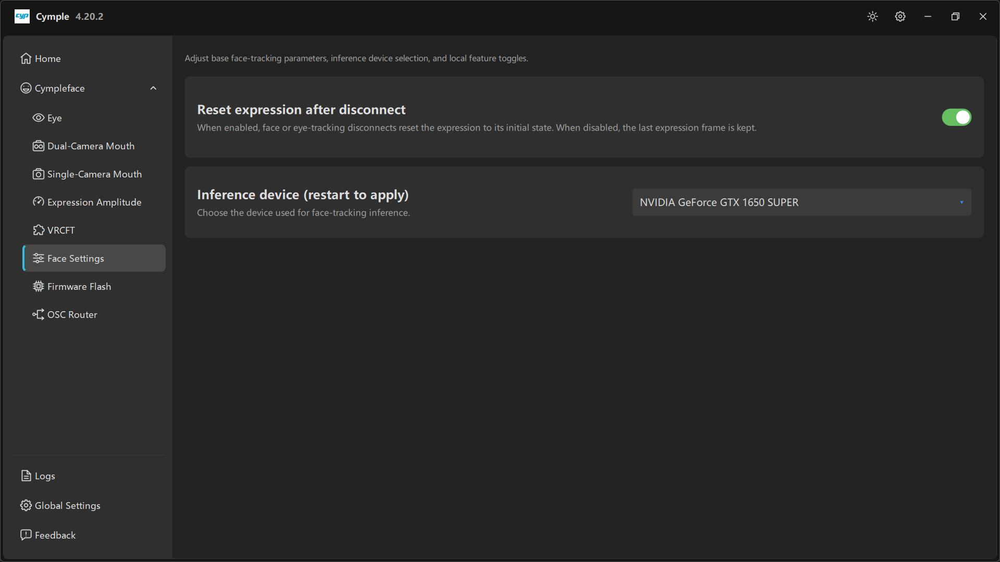

# Face Settings

*"Adjust base face-tracking parameters, inference device selection, and local feature toggles."*

Two settings, both with outsized effects.

## Reset expression after disconnect

| Property | Value |
|---|---|
| Default | **On** |
| Tooltip | *"When enabled, face or eye-tracking disconnects reset the expression to its initial state. When disabled, the last expression frame is kept."* |

| State | Behaviour | Choose when |
|---|---|---|
| **On** | On disconnect the avatar returns to neutral | Normal use — a dropped packet should not freeze a scream on your face |
| **Off** | The last solved frame is held indefinitely | Deliberate: keeping a pose through a brief hiccup, or diagnosing whether data actually stopped |

The same preference is exposed to third-party consumers as
`[Cymple_Mouth] reset_expression_on_tracking_disconnect` in the config file, which the VRCFT module
reads once per second. See [Configuration file](../reference/config.md).

> With the setting **off**, a real disconnect looks like a frozen face rather than a neutral one. If
> you are debugging "the avatar stopped moving", turn it back on: a neutral face is much easier to
> recognise as a failure.

## Inference device (restart to apply)

| Property | Value |
|---|---|
| Tooltip | *"Choose the device used for face-tracking inference."* |
| Example value | `NVIDIA GeForce GTX 1650 SUPER` |
| Restart required | **Yes** — the label says so literally |

The dropdown lists the compute devices the console found at startup. Typically:

- one entry per NVIDIA GPU with CUDA support,
- an integrated GPU entry if present,
- a CPU fallback.

### Choosing

| Situation | Choice |
|---|---|
| One NVIDIA GPU | Pick it — always the fastest option |
| NVIDIA GPU + iGPU | Pick the NVIDIA card, and make sure the headset/SteamVR run on the same GPU |
| AMD/Intel only | Use the CPU or the integrated device; expect lower frame rates and higher CPU load |
| Multiple NVIDIA GPUs | Prefer the one driving the headset |

### Why a restart is required

The inference engine allocates its context on the chosen device at process start. Switching at
runtime would mean tearing down and rebuilding the model, so the console asks you to restart instead.
Restarting the console is enough — SteamVR and VRChat can stay open.

### Verifying the choice took effect

1. Restart the console.
2. Open [Logs](logs.md) and look for the device banner near the top of the session.
3. Open [Eye](eye.md) or a mouth page and confirm `FPS`/`PPS` are healthy.

If the GPU entry disappears after a driver update, reselect it and restart — the list is rebuilt from
the driver's CUDA enumeration each launch.

## Interactions

- A slow inference device shows up as low **PPS** with a healthy **FPS**: frames arrive, processing
  cannot keep up. Fix the device, not the network.
- On a laptop, Windows may switch GPUs per application. Set the console to "High performance" in
  **Graphics settings** so it does not land on the iGPU.

---

**Next:** [Firmware Flash](firmware-flash.md) · [Troubleshooting](../reference/troubleshooting.md)

[Русская версия](../../ru/software/face-settings.md) · English
