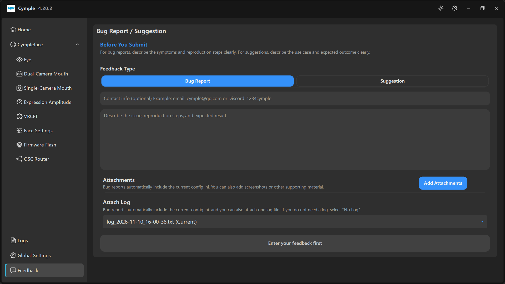

# Feedback

The in-app report form. It submits to the maintainer's tracker and can attach the config file and one
log automatically — which is exactly what makes a report actionable.

## Header

**Bug Report / Suggestion**

> **Before You Submit** — *"For bug reports, describe the symptoms and reproduction steps clearly. For
> suggestions, describe the use case and expected outcome clearly."*

## Feedback Type

Two large segmented buttons:

| Type | Use for |
|---|---|
| **Bug Report** (selected by default) | Something is broken or behaves incorrectly |
| **Suggestion** | A feature or improvement request |

## Contact info (optional)

> *"Contact info (optional) Example: email: cymple@qq.com or Discord: 1234cymple"*

Leave it blank for an anonymous report. Include it if you want a follow-up question.

## Description

A large free-text area: *"Describe the issue, reproduction steps, and expected result"*.

A report that gets fixed quickly contains:

1. **What you did** — numbered steps, from launching the console.
2. **What you expected** — one sentence.
3. **What happened** — one sentence, plus the exact wording of any message.
4. **Hardware** — eye tracker, mouth tracker (dual/single), DIY or kit.
5. **Environment** — headset, PC GPU, Wi-Fi band, VRChat or standalone tool.
6. **Version** — copy the banner from [Logs](logs.md).

The submit button is disabled until the description is non-empty — in our capture it reads
**Enter your feedback first**.

## Attachments

> *"Bug reports automatically include the current config ini. You can also add screenshots or other
> supporting material."*

**Add Attachments** opens a file picker. Screenshots of the failing page are worth more than a
paragraph of description, especially for preview and calibration problems.

## Attach Log

> *"Bug reports automatically include the current config ini, and you can also attach one log file.
> If you do not need a log, select «No Log»."*

| Option | Meaning |
|---|---|
| `log_…txt (Current)` | The live session's log — the right choice for a reproducible bug |
| An older file | A previous session; use when the bug happened before a restart |
| **No Log** | Nothing attached; use for suggestions and privacy-sensitive reports |

## What gets sent

| Item | Automatic | Notes |
|---|---|---|
| Description | — | Your text |
| Contact info | — | Only if you fill it in |
| Config INI | Yes, for bug reports | Contains device IPs and per-avatar amplitudes |
| Log file | Optional, one | Timestamps, versions, connection events |
| Screenshots | Optional | You choose the files |

> **Privacy.** The config file contains your local IP addresses and avatar parameter names. If that is
> sensitive for you, submit a suggestion instead, or trim the description and use **No Log**.

## Alternative channels

The project also takes reports outside the app:

- GitHub issues on the upstream repositories,
- the community Discord,
- the QQ group listed in the repository README.

Use whichever you will actually follow up on. In-app reports carry the most context automatically.

---

**Next:** [Logs](logs.md) · [Troubleshooting](../reference/troubleshooting.md)

[Русская версия](../../ru/software/feedback.md) · English
