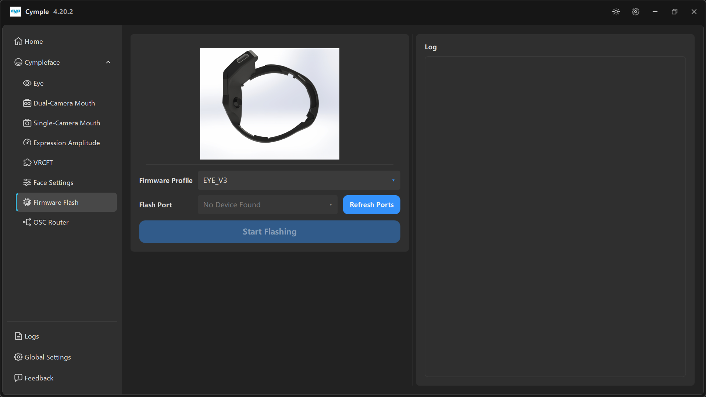

# Firmware Flash

The in-app flasher. It replaces the Arduino IDE for everyday firmware updates: choose a profile, pick
a COM port, press one button.

## Layout

| Column | Contains |
|---|---|
| Left | Product illustration, **Firmware Profile**, **Flash Port**, **Refresh Ports**, **Start Flashing** |
| Right | **Log** panel |

## Firmware Profile

*"Firmware Profile"* — the build to write.

| Value | Meaning |
|---|---|
| `EYE_V3` | Current eye tracker profile. Our capture shows this selected |
| Mouth profiles | For mouth tracker boards, single and dual variants |
| Kit profiles | For pre-built tracker / dongle hardware |

> The profile must match the physical board. A wrong profile usually still flashes successfully and
> then produces a stream the console misinterprets — the worst kind of failure, because everything
> *looks* connected.

If you are unsure which board you have, check the shell or the board silkscreen before flashing, and
prefer the version that was documented when you assembled the device.

## Flash Port

*"Flash Port"* — the serial port of the connected board.

- Shows **No Device Found** when no compatible USB-serial device is present.
- **Refresh Ports** rescans. Press it *after* plugging the board in; the list is not live.

Checklist when the port never appears:

1. **Cable.** Many USB cables are charge-only. Use one that carries data.
2. **Port.** Prefer a rear I/O port on a desktop, avoid unpowered hubs.
3. **Driver.** Device Manager must show a COM device — CH340, CP210x or FTDI — without a warning
   triangle.
4. **Bootloader.** Hold **BOOT**, tap **RST**, release **BOOT**, then **Refresh Ports**.
5. **Power.** Only one power source: USB, not USB *and* the headset.

## Start Flashing

The wide button. Progress and errors appear in the **Log** panel on the right.

| Log outcome | Meaning |
|---|---|
| Completion line, no errors | Firmware written; power-cycle the board |
| `Failed to connect` / timeout | Board not in bootloader, wrong port, or bad cable |
| Write error at a specific offset | Flash size mismatch or corrupt binary — re-download the release |

Do not unplug, do not press buttons, and do not close the console while writing. An interrupted flash
usually recovers by reflashing in bootloader mode, but occasionally needs a full erase.

## Log panel

Right-hand side. Monospace, scrolls. It shows the same messages the flashing library emits, which
makes it the authoritative source when the button seems to do nothing.

> The log panel here is *not* the same as [Logs](logs.md). This one shows flasher output only; the
> Logs page shows the whole application session.

## After a successful flash

1. Power-cycle the board.
2. Re-check its IP — a firmware update can drop a static address.
3. Update the IP on [Eye](eye.md) or the mouth page.
4. Re-run [Calibration](../guides/calibration.md); exposure defaults may have changed.

## Related

- [Firmware](../hardware/firmware.md) — profiles, recovery, ESP32 flash offsets.
- [Network setup](../hardware/network.md) — if the device is not reachable after flashing.

---

**Next:** [OSC Router](osc-router.md) · [Logs](logs.md)

[Русская версия](../../ru/software/firmware-flash.md) · English
