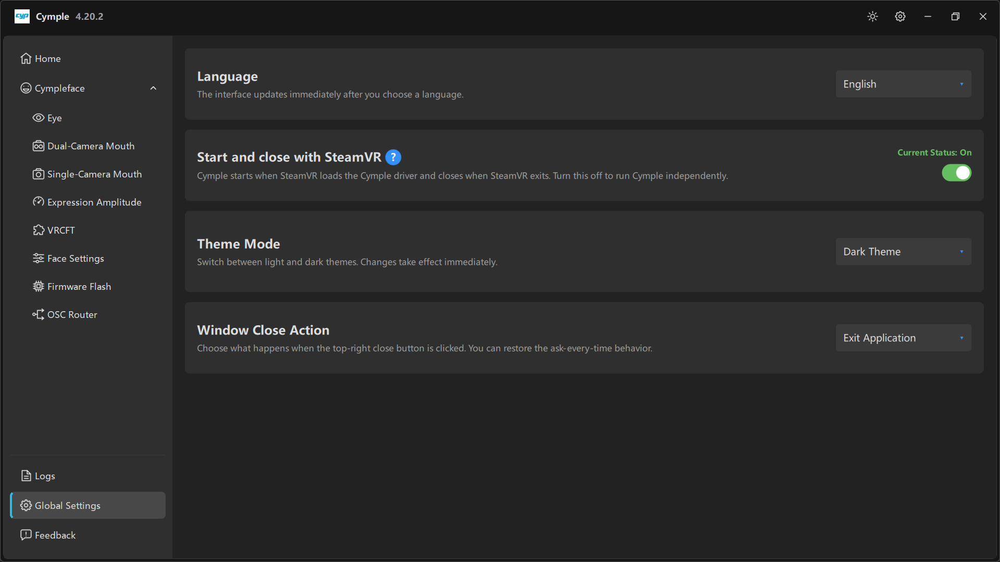

# Global Settings



Four application-level settings. None of them affect tracking quality, all of them affect how the
console behaves day to day.

## Language

*"The interface updates immediately after you choose a language."*

| Property | Value |
|---|---|
| Default | `English` |
| Applies | Instantly, no restart |
| Scope | UI only — logs, config keys and avatar parameters stay in English |

If you switch languages and some labels remain English, those strings are simply not translated in
your build yet; the setting is honest about the parts it covers.

## Start and close with SteamVR

*"Cymple starts when SteamVR loads the Cymple driver and closes when SteamVR exits. Turn this off to
run Cymple independently."* — **Current Status: On**

| State | Behaviour | Use when |
|---|---|---|
| **On** | Console lifetime follows SteamVR | Normal VR use — you never launch two apps |
| **Off** | You start and stop the console yourself | Debugging, or running the console without VR |

This is also how the console and the OpenVR driver stay in sync. If you turn it off, remember that
SteamVR can now start without the console, and the driver will have no data source.

Troubleshooting links:

- Console closes immediately when SteamVR starts → driver folder is corrupt or duplicated.
- Console does not start with SteamVR → driver not loaded; see [Installation](../getting-started/installation.md).
- Console closes and you lose calibration state → recalibrate; recentering is cheap.

## Theme Mode

*"Switch between light and dark themes. Changes take effect immediately."*

| Option | Notes |
|---|---|
| `Dark Theme` | Default in our captures; easier on the eyes next to a bright headset |
| `Light Theme` | Better in daylight; some screenshots in third-party guides use it |

The sun icon in the title bar toggles the same setting.

## Window Close Action

*"Choose what happens when the top-right close button is clicked. You can restore the ask-every-time behavior."*

| Option | Behaviour |
|---|---|
| `Exit Application` | Closes the console (and with it, tracking) |
| Minimize to tray (per build) | Keeps tracking alive with the window hidden |
| Ask every time | Shows a prompt each close |

If closing the window silently kills your tracking in the middle of a session, this is the setting to
change: pick the minimise-to-tray behaviour, or accept that closing the console intentionally stops
tracking.

## Where these are stored

All four live in the config file:

```ini
[Global]
language=English
start_with_steamvr=1
theme=dark
close_action=exit
```

Key names vary between releases; see [Configuration file](../reference/config.md) for how to read the
real file rather than guess.

---

**Next:** [Feedback](feedback.md) · [Configuration file](../reference/config.md)

<sub>[Русская версия](../../ru/software/global-settings.md) · English</sub>
