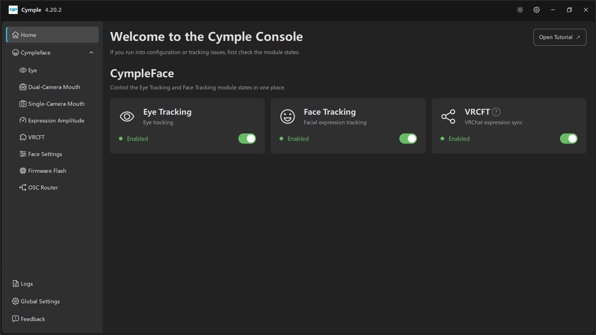

# Home

The landing page. It exists to answer one question before you start debugging anything else:
*are the modules actually on?*

## Header

| Element | Meaning |
|---|---|
| **Welcome to the Cymple Console** | Static heading |
| *"If you run into configuration or tracking issues, first check the module states."* | The console's own advice, and it is correct more often than not |
| **Open Tutorial ↗** | Opens the online tutorial in your browser |

## CympleFace

*"Control the Eye Tracking and Face Tracking module states in one place."*

Three cards, each with an icon, a title, a one-line subtitle, a status pill and a toggle:

| Card | Subtitle | What the switch controls |
|---|---|---|
| **Eye Tracking** | *Eye tracking* | Gaze, pupil and eyelid pipeline |
| **Face Tracking** | *Facial expression tracking* | Mouth/expression solver, including eyelid data |
| **VRCFT** | *VRChat expression sync* | The OSC/VRCFT output stage |

| Pill | Meaning |
|---|---|
| 🟢 **Enabled** | Module is initialised and running |
| ⚪ *Disabled* | Module is off; its pages still open, but previews stay blank |

### When to turn things off

- **Eye Tracking off** — you only have a mouth tracker, or you are debugging the face pipeline and
  want to remove variables.
- **Face Tracking off** — an eye-only setup, or a heavy GPU load you want to reduce. Note that eyelids
  are produced by the face solver on some builds; turning it off can cost you `Blink` data.
- **VRCFT off** — you are sending through an external VRCFaceTracking instance instead of VRC Direct,
  or you want to stop output while you calibrate.

### Turning things off is not the same as connecting

A green **Enabled** pill means *the subsystem is running*, not *a device is connected*. A tracker can
be enabled and still show zero devices — check the per-device pages
([Eye](eye.md), [Dual-Camera Mouth](dual-camera-mouth.md), [Single-Camera Mouth](single-camera-mouth.md))
and the `FPS`/`PPS` counters.

## Troubleshooting order

1. All three pills green on Home.
2. Live preview and non-zero `FPS` on the device page.
3. Non-zero **Input Rate** / **Output Rate** on [VRCFT](vrcft.md).
4. Avatar reacts in VRChat, OSC enabled in-game.

If step 1 fails, nothing downstream can work — that is exactly why the console puts this page first.

---

**Next:** [Eye](eye.md) · [VRCFT](vrcft.md)

[Русская версия](../../ru/software/home.md) · English
