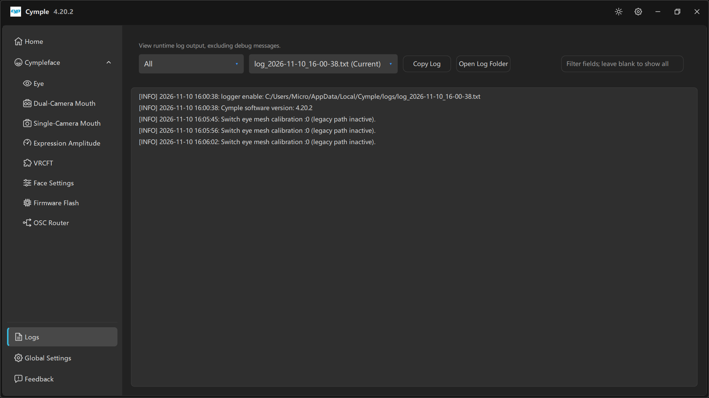

# Logs



*"View runtime log output, excluding debug messages."*

The log page is the first place to look when something is wrong and the last place most people look.
It shows the same text that is written to disk, without the debug-level noise.

## Controls

| Control | Function |
|---|---|
| Level dropdown (**All**) | Filter by severity: all, info, warning, error |
| File dropdown | `<log file> (Current)` for the live session, older files for previous runs |
| **Copy Log** | Copies the visible log to the clipboard — the fastest way to attach it to a report |
| **Open Log Folder** | Opens `%LOCALAPPDATA%\Cymple\logs\` in Explorer |
| Filter field | *"Filter fields, leave blank to show all"* — substring match over the log lines |

## What a healthy session looks like

```text
[INFO] 2026-11-10 16:00:38: logger enable: C:/Users/<user>/AppData/Local/Cymple/logs/log_2026-11-10_16-00-38.txt
[INFO] 2026-11-10 16:00:38: Cymple software version: 4.20.2
[INFO] 2026-11-10 16:05:45: Switch eye mesh calibration :0 (legacy path inactive).
```

| Line | Why it matters |
|---|---|
| `logger enable: …` | Where this session's log lives — useful when a user sends the wrong file |
| `Cymple software version: …` | The authoritative version; the title bar can lag behind a hot-swapped build |
| `Switch eye mesh calibration :0 (legacy path inactive).` | Calibration mode switch. `legacy path inactive` is normal on current builds |

A working pipeline is **quiet**: the device connects once, calibration is announced once, and then
nothing until you change something. A log that scrolls continuously is a device reconnecting in a loop.

## Reading failures

| Log pattern | Interpretation |
|---|---|
| Repeated connection attempts to an IP | Camera unreachable — network, not the console |
| `Switch eye mesh calibration` repeating | Calibration being re-triggered, possibly by a hotkey or a UI loop |
| Stack traces / `Exception` | Console-side fault; capture the log and report it |
| Nothing at all after the version banner | Modules disabled on [Home](home.md), or the console is idle by design |

## Log files on disk

| Property | Value |
|---|---|
| Folder | `%LOCALAPPDATA%\Cymple\logs\` |
| Name | `log_YYYY-MM-DD_HH-MM-SS.txt` |
| Lifetime | One file per session; old files are kept until you delete them |
| Encoding | UTF-8 text, one timestamped line per event |

Retention is manual — nothing is pruned automatically. If you file bug reports often, clear the
folder periodically so the file dropdown stays usable.

## How to report a bug properly

1. Reproduce the problem once with the console freshly started.
2. Open **Logs**, select the current file.
3. **Copy Log**.
4. Open [Feedback](feedback.md), describe symptoms and reproduction steps, attach the log there, and
   mention the version from the banner.

See [Feedback](feedback.md) for the full report template.

---

**Next:** [Global Settings](global-settings.md) · [Feedback](feedback.md)

<sub>[Русская версия](../../ru/software/logs.md) · English</sub>
