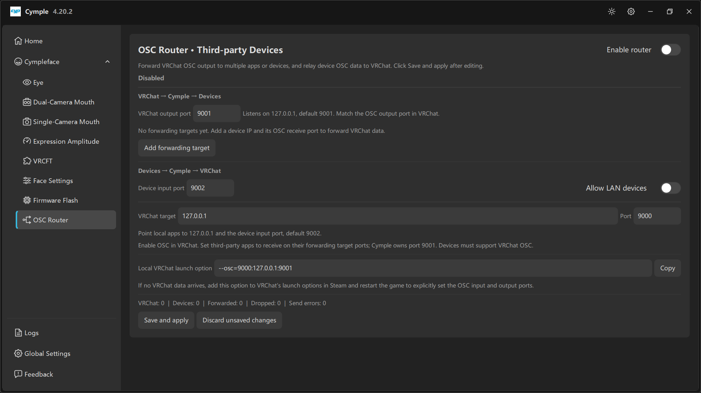

# OSC Router



The router turns the console into an OSC hub. It can send VRChat's parameters to other apps and
devices, and it can inject data coming from those devices back into VRChat.

This is the only page in the console with an explicit **Save and apply** — edits are staged until you
commit them.

## Header

**OSC Router · Third-party Devices** — *"Forward VRCHat OSC output to multiple apps or devices, and
relay device OSC data to VRCHat. Click Save and apply after editing."*

Top-right: **Enable router** toggle. While it is off, the section header reads **Disabled** and
nothing is forwarded or relayed.

## VRCHat → Cymple → Devices

Data leaving VRChat, captured by the console and fanned out.

| Field | Default | Notes |
|---|---|---|
| **VRCHat output port** | `9001` | *"Listens on 127.0.0.1, default 9001. Match the OSC output port in VRCHat."* |

### Forwarding targets

*"No forwarding targets yet. Add a device IP and its OSC receive port to forward VRCHat data."*

**Add forwarding target** appends a row. Each row takes:

- **device IP** — the receiving app or device,
- **OSC receive port** — where that app listens.

Use cases:

| Target | Typical port | Why |
|---|---|---|
| A phone app that mirrors avatar parameters | the app's own port | VRChat parameter display |
| A second PC running an OSC tool | that tool's port | Debugging or logging |
| A haptic or accessory device | vendor port | Reacts to expressions |

> Adding a target does not consume VRChat's output — the console listens once and re-emits to every
> target, so VRChat keeps sending to a single address.

## Devices → Cymple → VRCHat

Data flowing the other way: from devices/libs into VRChat.

| Field | Default | Notes |
|---|---|---|
| **Device input port** | `9002` | Where local apps should send OSC destined for VRChat |
| **Allow LAN devices** | Off | *Off* = loopback only; *On* = accept from other hosts on the LAN |
| **VRCHat target** | `127.0.0.1` | Where VRChat listens |
| **Port** | `9000` | VRChat's receive port |

> *"Point local apps to 127.0.0.1 and the device input port, default 9002. Enable OSC in VRCHat. Set
> third-party apps to receive on their forwarding target ports; Cymple owns port 9001. Devices must
> support VRCHat OSC."*

Two consequences worth internalising:

1. **Cymple owns 9001.** Any other app that wants VRChat's output must receive it through a forwarding
   target, not by binding 9001 itself.
2. **`Allow LAN devices` is a security switch.** It opens the router to your network. Keep it off on
   shared Wi-Fi.

## Local VRCHat launch option

```text
--osc=9000:127.0.0.1:9001
```

With a **Copy** button.

> *"If no VRCHat data arrives, add this option to VRCHat's launch options in Steam and restart the
> game to explicitly set the OSC input and output ports."*

Reading the option: VRChat listens on `9000`, and sends to `127.0.0.1:9001` — exactly the pairing the
console expects. Set it in Steam: **VRChat → Properties → General → Launch Options**.

## Statistics

```text
VRCHat: 0 | Devices: 0 | Forwarded: 0 | Dropped: 0 | Send errors: 0
```

| Counter | Meaning | If it stays at 0 |
|---|---|---|
| **VRCHat** | Messages received from VRChat | OSC off in-game, wrong port, router disabled |
| **Devices** | Messages received from devices/apps | Nothing is sending to 9002, or LAN devices blocked |
| **Forwarded** | Messages successfully re-sent | No forwarding targets configured |
| **Dropped** | Messages discarded (queue/validation) | Rate too high; reduce targets or traffic |
| **Send errors** | Failed sends | Wrong target IP/port, target offline |

Rising **Dropped** with flat **Forwarded** usually means a dead target on the list.

## Save semantics

| Action | Effect |
|---|---|
| **Save and apply** | Writes settings and starts routing immediately |
| **Discard unsaved changes** | Reverts the page to the last saved state |
| Leaving the page without saving | Edits are lost; routing keeps running with the old config |

The **Enable router** toggle also follows save semantics: flipping it alone does nothing until
applied.

## Recipes

**Phone parameter monitor**

1. **Enable router** on.
2. Add a forwarding target with the phone's IP and the app's port.
3. Save and apply. VRChat still talks only to the console.

**Second app that needs VRChat parameters**

Same as above, one more target row. Both receive identical data.

**Feeding a device's OSC into VRChat**

1. Set the device to send to `127.0.0.1:9002`.
2. Leave **VRCHat target** at `127.0.0.1:9000`.
3. Save and apply, then confirm **Devices** increments.

---

**Next:** [Logs](logs.md) · [Ports and endpoints](../reference/ports.md)

<sub>[Русская версия](../../ru/software/osc-router.md) · English</sub>
