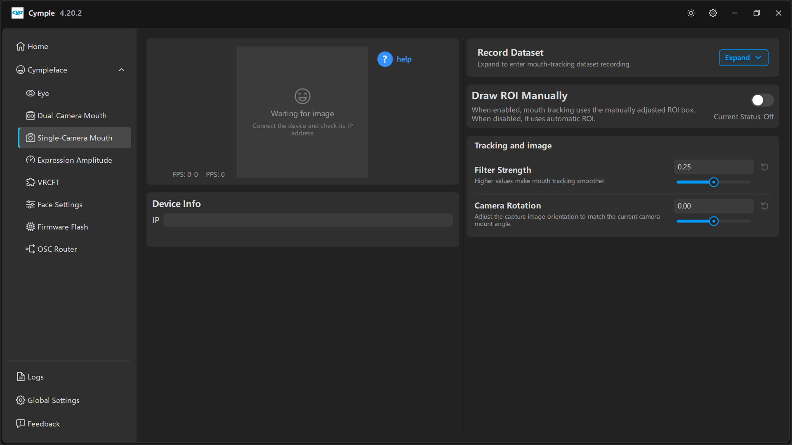

# Single-Camera Mouth

The monocular mouth tracker page. Fewer controls than the stereo page — one image, one IP, one
rotation and one filter — plus the **Draw ROI Manually** switch that matters most when automatic
tracking struggles.

## Layout

| Column | Contains |
|---|---|
| Left | Single **image** preview, **FPS**/**PPS**, **help** button, **Device Info** |
| Right | **Record Dataset**, **Draw ROI Manually**, **Tracking and image** |

## Preview

A dashed placeholder with *"Waiting for image"* and *"Connect the device and check its IP address"*
means no stream. Once connected:

| Counter | Meaning |
|---|---|
| **FPS** | Frames per second from the camera |
| **PPS** | Processed samples per second |

## Help

The blue **? help** button in the preview corner opens contextual help for this page — a good first
stop for the current build's exact hints, since they are updated more often than this wiki.

## Device Info

A single **IP** field for the camera.

## Record Dataset

*"Expand to enter mouth-tracking dataset recording."*

Collapsed by default. Expanded, it captures labelled frames. See
[Dataset recording](../guides/dataset-recording.md).

## Draw ROI Manually

> *"When enabled, mouth tracking uses the manually adjusted ROI box. When disabled, it uses automatic
> ROI."* — **Current Status: Off**

The ROI (region of interest) is the rectangle the solver treats as "the mouth". Automatic mode finds
it every frame; manual mode pins it.

| Mode | Use when |
|---|---|
| **Off** (automatic) | Normal setups; the box follows the face and tolerates headset slippage |
| **On** (manual) | Unusual framing, a very close camera, heavy facial hair, or a headset where automatic detection keeps grabbing the nose |

Turning it on reveals a draggable box in the preview. Keep the corners of the mouth inside the box at
maximum smile, but do not make it so large that it captures the chin.

> Manual ROI does **not** follow the headset. Recenter or redraw it after any fit change.

## Tracking and image

| Parameter | Default | Tooltip |
|---|---|---|
| **Filter Strength** | `0.25` | *"Higher values make mouth tracking smoother."* |
| **Camera Rotation** | `0.00` | *"Adjust the capture image orientation to match the current camera mount angle."* |

**Camera Rotation** is the fix for a tilted arm: rotate until the face is level in the preview, then
leave it. A rotated image degrades lip-corner detection noticeably.

## Expectation setting

A single camera has no stereo depth. Compared with the dual-camera build:

| Expression | Mono quality |
|---|---|
| Jaw Open, Mouth Close, Smile, Frown | Good |
| Puck, LipFunnel, Upper Lip Raise | Good |
| CheekPuff, Cheek Suck | Weak |
| Jaw Fwd, Jaw Shift | Weak to fair |

Compensate with [Expression Amplitude](expression-amplitude.md) rather than with the camera.

---

**Next:** [Expression Amplitude](expression-amplitude.md) · [VRCFT](vrcft.md)

[Русская версия](../../ru/software/single-camera-mouth.md) · English
