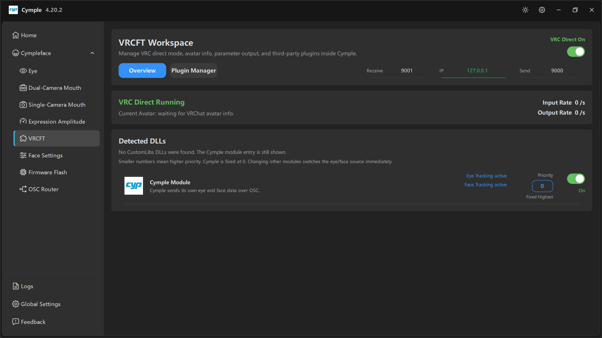

# VRCFT

The output stage. Everything the trackers produce arrives here and leaves either directly to VRChat
(**VRC Direct**) or through a VRCFaceTracking module.

## Header

**VRCFT Workspace** — *"Manage VRC direct mode, avatar info, parameter output, and third-party
plugins inside Cymple."*

Top-right: **VRC Direct On** (green) with a toggle. This single switch decides the whole delivery
path.

| VRC Direct | Behaviour |
|---|---|
| **On** | The console sends avatar parameters to VRChat itself over OSC. No external app needed. Compatibility packets for the VRCFT module are **not** sent |
| **Off** | The console stays silent towards VRChat and only emits the compatibility stream that the Cymple VRCFT module consumes. Use this when VRCFaceTracking is the integrator |

Turning direct mode off is what makes an external VRCFaceTracking setup work — and it is the single
most common reason a module shows "no data".

## Tabs

| Tab | Content |
|---|---|
| **Overview** | Ports, live rates, detected modules |
| **Plugin Manager** | Manage third-party DLLs loaded into the workspace |

## Ports

| Field | Default | Meaning |
|---|---|---|
| **Receive** | `9001` | Port the console listens on to hear **VRChat's** OSC output. VRChat's default send port |
| **IP** | `127.0.0.1` | Where VRChat runs; loopback is correct for a single PC |
| **Send** | `9000` | Port the console sends to. VRChat's default receive port |

VRChat's own defaults are "receive 9000, send 9001", so the defaults pair up with an untouched
VRChat. If you changed VRChat's OSC ports, mirror them here — see [Ports and endpoints](../reference/ports.md).

## VRC Direct Running

Status card, with three live readings:

| Reading | Meaning | Expected |
|---|---|---|
| **Current Avatar** | *"waiting for VRChat avatar info."* until VRChat reports one | Avatar name once in world |
| **Input Rate** | Parameters per second received *from* VRChat | Non-zero in VRChat, `0/s` in the menu |
| **Output Rate** | Parameters per second sent *to* VRChat | Should track input rate |

Diagnosis table:

| Input | Output | Meaning |
|---|---|---|
| `0/s` | `0/s` | VRChat not running, OSC disabled in-game, or wrong ports |
| `>0` | `0/s` | Receiving but not sending — module disabled, or no data from trackers |
| `>0` | `>0` | Working |

If **Input Rate** is `0/s` while VRChat is running, the problem is VRChat→console, not tracking.
Enable OSC in VRChat and verify the launch option on [OSC Router](osc-router.md).

## Detected DLLs

> *"No CustomLibs DLLs were found. The Cymple module entry is still shown."*
>
> *"Smaller numbers mean higher priority. Cymple is fixed at 0. Changing other modules switches the
> eye/face source immediately."*

The list shows every module the workspace knows about, including the built-in one even when no
third-party DLLs are installed.

Each row has:

| Element | Meaning |
|---|---|
| Module icon and name | e.g. **Cymple Module** |
| Description | *"Cymple sends its own eye and face data over OSC."* |
| **Eye Tracking active** / **Face Tracking active** | Which domains this module currently owns |
| **Priority** box | Numeric priority; **Fixed Highest** for Cymple at `0` |
| Toggle | Enable/disable the module |

### Priority rules

- Lower number = higher priority.
- **Cymple is pinned at `0`** and cannot be demoted; it is the built-in source.
- A third-party module with a higher number loses the domain to Cymple; give it priority only if you
  actually want it to replace Cymple's eye or face data.
- Switching priority takes effect immediately — no restart.

## Choosing your path

**Simplest: VRC Direct**

1. **VRC Direct** on.
2. Ports left at `9001` / `127.0.0.1` / `9000`.
3. OSC enabled in VRChat.
4. Watch **Output Rate** go non-zero.

**External VRCFaceTracking**

1. **VRC Direct** off.
2. Install `CympleFaceTracking.dll` through VRCFaceTracking's custom module installer.
3. Start VRCFaceTracking before VRChat.
4. Follow [External VRCFT](../guides/external-vrcft.md) for avatar parameters.

**Mixed modules**

1. Keep **VRC Direct** on if you want Cymple's own output.
2. Install other DLLs, set their priority above or below Cymple per domain.
3. Watch the **active** labels on each row to confirm who owns eye and face.

## Common problems

| Symptom | Fix |
|---|---|
| **VRC Direct On** but output stays `0/s` | No tracker data; check previews and [Home](home.md) pills |
| Avatar never detected | OSC disabled in VRChat, or inbound port blocked by the firewall |
| External module gets no data | **VRC Direct** is still on — turn it off |
| Two sources fight over the face | Adjust **Priority**, remember Cymple is fixed at 0 |

---

**Next:** [Face Settings](face-settings.md) · [OSC Router](osc-router.md)

[Русская версия](../../ru/software/vrcft.md) · English
