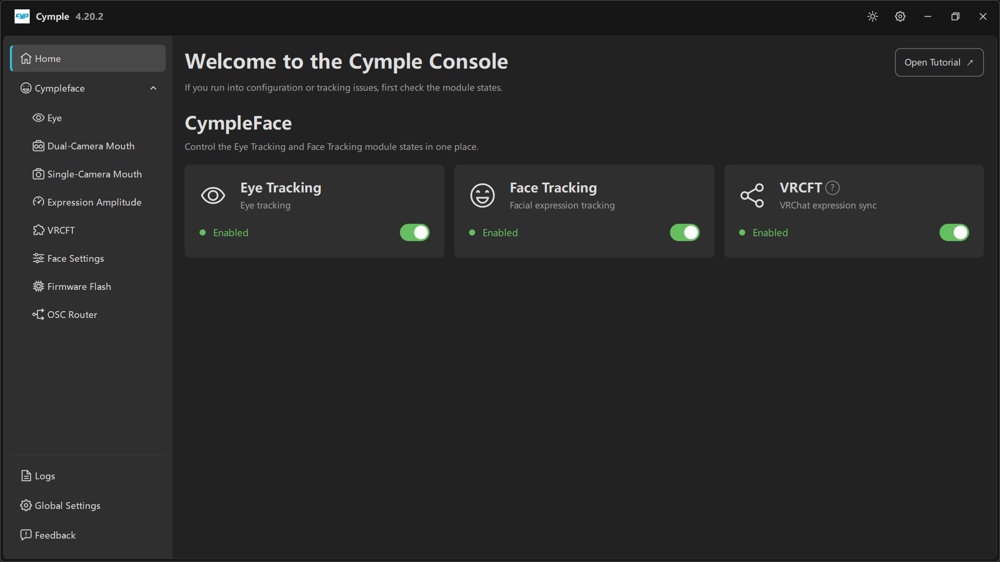
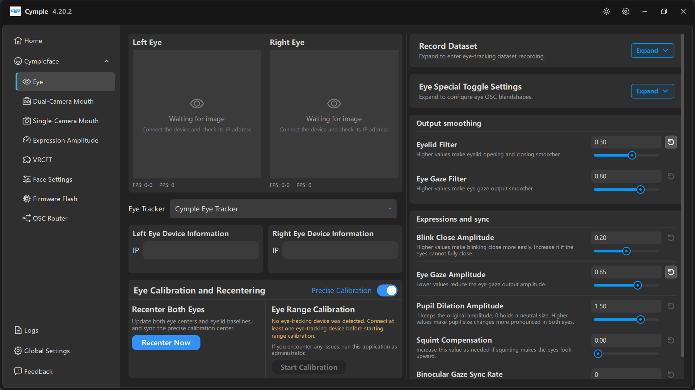
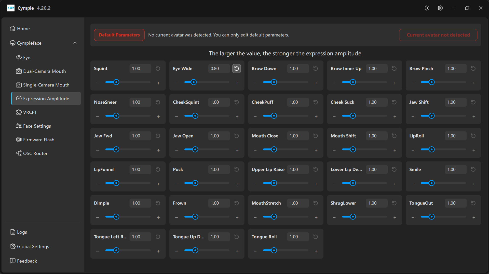

# Быстрый старт

Это самый короткий путь, который заканчивается тем, что аватар моргает и смотрит по сторонам.
Предполагается, что железо уже собрано и подключено к питанию; если нет — начните с раздела
[Железо](../hardware/index.md).

## Шаг 1 — Питание и подключение к сети

1. Подайте питание на трекер (USB-батарея или USB-порт шлема).
2. Камерный модуль загружается в режиме Wi-Fi-клиента с теми учётными данными, которые вы в него
   прошили. Стандартные сборки подключаются к SSID из конфигурации устройства; как его изменить —
   см. [Настройка сети](../hardware/network.md).
3. Запишите IP устройства. Он выводится в последовательный порт устройства, а после подключения
   консоли виден в полях **IP**.

## Шаг 2 — Откройте консоль и включите модули

На странице [Home](../software/home.md) проверьте три переключателя:

- **Eye Tracking** — включён
- **Face Tracking** — включён (даже в конфигурации только со взглядом решатель мимики выдаёт данные
  о веках)
- **VRCFT** — включён, если нужен вывод через VRC Direct

Когда подсистема работает, на карточке горит зелёная плашка **Enabled**.

## Шаг 3 — Введите IP устройств

1. Откройте **Cympleface → Eye**.
2. Установите **Eye Tracker** в `Cymple Eye Tracker`.
3. Введите IP левой камеры в **Left Eye Device Information → IP**, правой — в
   **Right Eye Device Information → IP**.
4. Дождитесь предпросмотров. Значения `FPS` и `PPS` в левом нижнем углу каждого предпросмотра должны
   быть не нулевыми; здоровая самодельная камера для глаза выдаёт около 25–30 FPS на 5 ГГц.

Если у вас только трекер рта, сделайте то же самое на страницах
[Dual-Camera Mouth](../software/dual-camera-mouth.md) или
[Single-Camera Mouth](../software/single-camera-mouth.md) → **Device Info → IP**.

## Шаг 4 — Калибровка

1. Смотрите прямо вперёд, затем нажмите **Recenter Now** в блоке **Recenter Both Eyes**.
2. Посмотрите на каждую из девяти точек в **Eye Range Calibration** и нажмите **Start Calibration**.
   Если кнопка неактивна, консоль ещё не обнаружила устройство — сначала исправьте шаг 3.
3. По желанию включите **Precise Calibration**: решение будет медленнее, но точнее.

Подробно: [Калибровка](../guides/calibration.md).

## Шаг 5 — Выберите путь вывода

**Напрямую (проще всего)**

1. [VRCFT](../software/vrcft.md) → включите **VRC Direct**.
2. Убедитесь, что стоят **Receive 9001**, **IP 127.0.0.1**, **Send 9000**.
3. В VRChat включите OSC (**Options → OSC → Enabled**).
4. Статус должен показывать **VRC Direct Running** и ненулевой **Output Rate**.

**Внешний VRCFT**

1. Выключите **VRC Direct**.
2. Запустите VRCFaceTracking с установленным модулем Cymple.
3. Добавьте параметры модуля в аватар — см. [Настройка VRChat](../guides/vrchat-setup.md).

## Шаг 6 — Подстройте выражения

Откройте **Expression Amplitude**. Красный баннер *«No current avatar was detected»* означает, что
консоль редактирует **параметры по умолчанию** — это нормально, пока VRChat не сообщит об аватаре.

Начните с `1.00` для всего, а затем правьте только то, что выглядит неправильно:

| Симптом | Что настроить |
|---|---|
| Глаза закрываются слишком сильно или слишком слабо | **Blink Close Amplitude** на странице [Eye](../software/eye.md) |
| Взгляд слишком дёрганый | **Eye Gaze Filter**, поднимите к `0.9` |
| Взгляд слишком слабый | **Eye Gaze Amplitude**, поднимите к `1.0` |
| Прищур выглядит неправильно | **Squint Compensation** |
| Формы рта слишком сильные | Соответствующий ползунок на этой странице, опустите до `0.7`–`0.8` |

## Шаг 7 — Сохраните и проверьте

- Страницы рта требуют явного **Save and apply** только в [OSC Router](../software/osc-router.md);
  всё остальное применяется сразу.
- Пока тестируете, держите консоль на [Logs](../software/logs.md). Работающий конвейер пишет
  подключение устройства один раз, а дальше молчит.

## Чек-лист

- [ ] Оба предпросмотра взгляда показывают живую картинку
- [ ] `FPS` > 20, `PPS` > 20
- [ ] Перецентровка выполнена после надевания шлема
- [ ] Диапазонная калибровка пройдена
- [ ] Частота вывода не нулевая во время работы VRChat
- [ ] Аватар моргает, когда моргаете вы

---

**Далее:** [Калибровка](../guides/calibration.md) · [Настройка VRChat](../guides/vrchat-setup.md)

[English version](../../en/getting-started/quick-start.md) · Русский · ИИ-перевод: DeepSeek-V4.1--Flash
