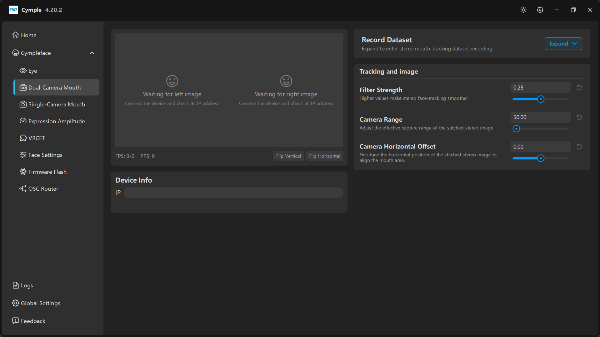

# Трекер рта на двух камерах

Две камеры направлены на нижнюю часть лица. Стереопара даёт решателю глубину — именно она отличает
убедительную челюсть от плоской и делает `Jaw Fwd`, `Jaw Shift` и `CheekPuff` пригодными к
использованию.

## Детали

| Деталь | Примечания |
|---|---|
| 2 × камерный модуль ESP32 | Установлены рядом, база фиксирована |
| Напечатанный корпус | `模型/面捕/` — вариант `双目面捕` (стерео) |
| Рассеиватель или матовая панель | Необязательно; убирает пересветы от настольной лампы или окна |
| Питание | USB 5 В, общее с айтрекером, если он есть |
| Крепёж | Саморезы M2×6 |

## Сборка

1. **Напечатайте** стереокорпус и дугу под шлем для своего шлема.
2. **Прошейте** обе платы профилем для рта (см. [Прошивку](firmware.md)).
3. **Установите** камеры с **той базой**, которую собираетесь сохранить. После склейки или
   завинчивания не двигайте их по отдельности: калибровка сшивки рассчитана на неизменную геометрию.
4. **Закрепите** дугу так, чтобы обе камеры видели рот, подбородок и щёки. Полезный ориентир — нос:
   если кончик носа обрезан сверху кадра, чуть наклоните дугу вверх.
5. **Защитите** пару от изгиба. Разболтанная дуга — это уезжающая сшивка, и вы увидите рот, который
   медленно смещается в сторону по ходу сеанса.

## Подключение

1. Откройте [Dual-Camera Mouth](../software/dual-camera-mouth.md).
2. Введите IP камеры в **Device Info → IP**.
3. Оба предпросмотра должны показывать живую картинку; `FPS`/`PPS` внизу должны меняться.
4. Кнопками **Flip Vertical** / **Flip Horizontal** приведите ориентацию изображения в соответствие
   с реальностью: эти кнопки меняют то, как консоль трактует кадр, поэтому нажимайте их *до*
   настройки.

## Выравнивание сшивки

Консоль сшивает два изображения в одно представление рта. Важны три элемента управления:

| Элемент | Что делает | Как настроить |
|---|---|---|
| **Camera Range** | Эффективный диапазон захвата сшитого изображения | Уменьшите, если рот выглядит слишком мелким; увеличьте, если подбородок или щёки обрезаны |
| **Camera Horizontal Offset** | Сдвигает сшивку по горизонтали | Двигайте, пока рот не окажется по центру и обе половины не совпадут на стыке |
| **Filter Strength** | Временное сглаживание данных рта | По умолчанию `0.25`; увеличьте при шатком креплении, уменьшите для более отзывчивых губ |

Правильная сшивка выглядит как одно непрерывное лицо: посередине нет видимого шва, рот по центру, а
линия челюсти непрерывна на границе.

## Советы по отслеживанию

- **Рот должен оставаться в кадре** при максимальной улыбке и максимально опущенной челюсти.
  Проверьте оба положения, прежде чем закрывать корпус.
- **Ровный свет.** Окно за спиной даёт силуэт, и детектор губ теряет границу.
- **Не меняйте длину бороды посреди калибровки.** Растительность на лице меняет край губ;
  откалибруйтесь заново после стрижки.
- Если `Mouth Close` всегда чуть приоткрыт, вероятно, **Camera Range** задан слишком широко и губы
  занимают всего несколько пикселей. Сузьте диапазон.

## Запись датасета

Если хотите дообучить решатель на своём лице, панель **Record Dataset** на той же странице записывает
размеченные кадры. См. [Запись датасета](../guides/dataset-recording.md).

---

**Далее:** [Трекер рта на одной камере](single-camera-mouth.md) · [Настройка сети](network.md)

[English version](../../en/hardware/dual-camera-mouth.md) · Русский · ИИ-перевод: DeepSeek-V4.1--Flash
