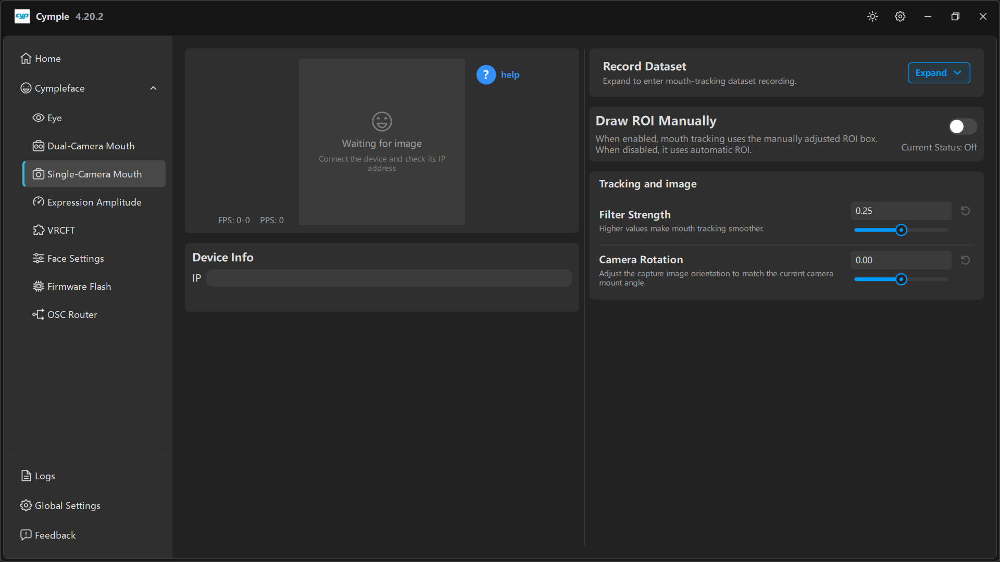

# Трекер рта на одной камере

Одна камера, один IP, одно изображение. Дешевле и легче стереопары, но с чуть более слабыми
признаками глубины: `Jaw Fwd` и `CheekPuff` менее достоверны, а губы, брови и язык отслеживаются
нормально.

## Детали

| Деталь | Примечания |
|---|---|
| 1 × камерный модуль ESP32 | Любая плата, которая помещается в корпус `单目面捕` |
| Напечатанный корпус | `模型/面捕/` — моновариант, плюс дуга под шлем |
| Питание | USB 5 В |
| Крепёж | Саморезы M2×6 |

## Сборка

1. **Напечатайте** монокорпус и дугу.
2. **Прошейте** прошивку для рта, прежде чем закрывать корпус ([Прошивка](firmware.md)).
3. **Установите** камеру так, чтобы рот занимал нижнюю треть кадра, а переносица была чуть видна
   сверху: такое кадрирование даёт решателю стабильную вертикальную привязку.
4. **Закрепите** дугу под удобным углом. Добивайтесь, чтобы камера смотрела на рот слегка *снизу
   вверх*: при направлении сверху вниз верхняя губа скрывается за носом.
5. **Проверьте охват**: камера должна видеть рот и при широкой улыбке.

## Подключение

1. Откройте [Single-Camera Mouth](../software/single-camera-mouth.md).
2. Введите IP в **Device Info → IP**.
3. Дождитесь предпросмотра и ненулевого `FPS`.
4. Кнопкой **Camera Rotation** выровняйте изображение, если дуга установлена под углом.

## Ручной ROI (область интереса)

По умолчанию консоль находит рот автоматически. Если кадрирование необычное — очень близкая камера,
нестандартный шлем, частичная борода — область можно закрепить вручную:

1. Включите **Draw ROI Manually**. Строка состояния меняется с **Current Status: Off** на *On*.
2. Нарисуйте рамку вокруг области рта в предпросмотре.
3. Держите рамку плотной, но без обрезки: углы рта должны оставаться внутри неё даже при
   максимальной улыбке.
4. Выключите её обратно, чтобы вернуться к автоматическому ROI. Если автоматическое отслеживание
   работает нормально, оставьте ручной режим выключенным — рамка не отследит смещение шлема.

## Настройка

| Элемент | Действие |
|---|---|
| **Filter Strength** | Сглаживание; `0.25` — хорошее начало. Увеличьте при шатком креплении |
| **Camera Rotation** | Поворачивает захват, чтобы выровнять лицо; настройте один раз и оставьте |

Поскольку стереобазы нет, настраивайте через
[Амплитуду выражений](../software/expression-amplitude.md), а не подкручивая камеру:

- `Jaw Open` слишком сильный → опустите до `0.8`.
- `Mouth Close` слабый → чуть поднимите, но сначала проверьте, что губы не обрезаны кадром.
- `CheekPuff` почти не двигается → ожидаемо для монокуляра; компенсируйте в аватаре, если это важно.

## Когда переходить на стерео

Выбирайте сборку с двумя камерами, если вам нужны:

- правдоподобные `Jaw Fwd` / `Jaw Shift`,
- `CheekPuff` и `Cheek Suck`, реагирующие на реальное изменение объёма,
- устойчивое отслеживание при небольшом смещении шлема.

---

**Далее:** [Настройка сети](network.md) · [Прошивка](firmware.md)

[English version](../../en/hardware/single-camera-mouth.md) · Русский · ИИ-перевод: DeepSeek-V4.1--Flash
