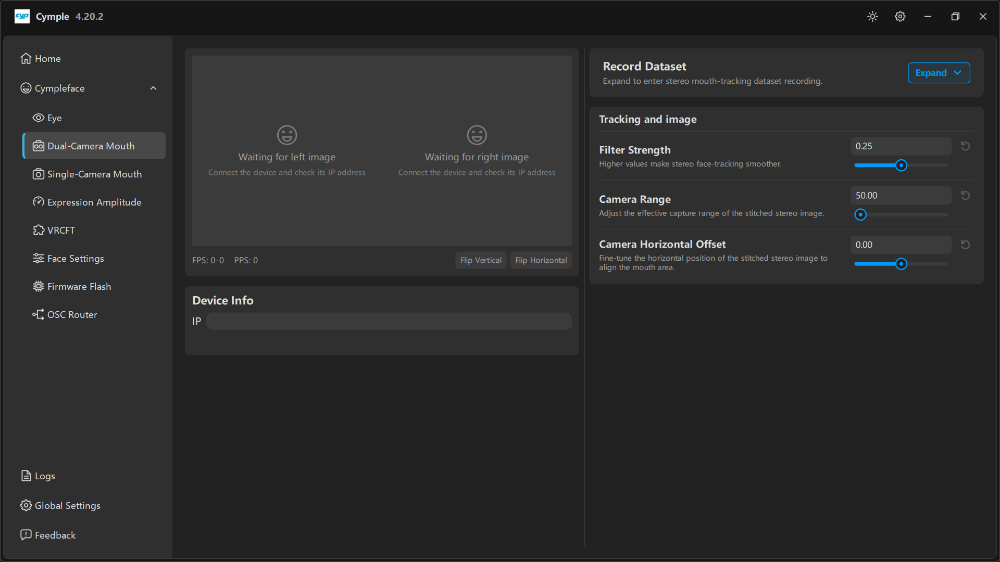

# Dual-Camera Mouth

Страница стереотрекинга мимики. В левой колонке — вход с устройства и предпросмотры, в правой —
запись и три параметра изображения и трекинга, от которых зависит, получит ли решатель выражений
что-нибудь пригодное для работы.

## Раскладка

| Колонка | Содержимое |
|---|---|
| Слева | Предпросмотры **Left/Right image**, **FPS**/**PPS**, **Flip Vertical** / **Flip Horizontal**, **Device Info** |
| Справа | **Record Dataset**, **Tracking and image** |

## Предпросмотры

Показаны обе половины стереопары. Пунктирная заглушка с надписями *"Waiting for left image"* /
*"Waiting for right image"* и *"Connect the device and check its IP address"* означает, что потока
нет.

| Счётчик | Значение |
|---|---|
| **FPS** | Кадров в секунду с пары |
| **PPS** | Обработанных отсчётов в секунду |

## Flip Vertical / Flip Horizontal

Две кнопки-переключателя под предпросмотрами. Они исправляют корпус, установленный вверх ногами или
зеркально, — обычная ситуация, когда шлейф камеры дотягивается только в одну сторону.

> Делайте отражение **до** настройки **Camera Range** и **Camera Horizontal Offset**. Отражение
> после настройки обнуляет смещения, и настраивать придётся дважды.

Если изображение повёрнуто на 90°, а не отражено, значит корпус закреплён под прямым углом;
исправьте это механически — элемента поворота на этой странице нет.

## Device Info

Одно поле **IP**: стереопара адресуется как одно устройство. Введите IP потокового интерфейса пары.

## Record Dataset

*«Разверните, чтобы перейти к записи датасета стереотрекинга мимики.»*

Свёрнута по умолчанию. В развёрнутом виде записывает размеченные стереокадры для переобучения или
дообучения. См. [Запись датасета](../guides/dataset-recording.md).

## Tracking and image

| Параметр | По умолчанию | Подсказка | Рабочий диапазон |
|---|---|---|---|
| **Filter Strength** | `0.25` | *«Большие значения делают стереотрекинг мимики плавнее.»* | `0.15` — резко · `0.4` — плавно |
| **Camera Range** | `50.00` | *«Настраивает эффективный диапазон съёмки сшитого стереоизображения.»* | `35`–`70` |
| **Camera Horizontal Offset** | `0.00` | *«Тонко подстраивает горизонтальное положение сшитого стереоизображения, чтобы совместить область рта.»* | `-15`–`+15` |

### Порядок настройки

1. Сначала **Camera Range** — правильно впишите лицо в кадр. Слишком широко — губы занимают
   несколько пикселей; слишком узко — обрезан подбородок.
2. Затем **Camera Horizontal Offset** — отцентруйте рот и спрячьте шов сшивки.
3. **Filter Strength** последней — она меняет ощущение от результата, а не сами измерения.

### Симптомы и причины

| Симптом | Вероятная причина |
|---|---|
| `Mouth Close` никогда не доходит до 0 | Слишком широкий диапазон, губы слишком мелкие в кадре |
| Рот «уезжает» вбок за сеанс | Разболталось крепление или смещение настраивали на согнутой штанге |
| Виден шов посередине | Сбито горизонтальное смещение; отцентруйте заново |
| Выражения отстают примерно на 200 мс | Слишком велика **Filter Strength** |
| Выражения дёргаются между кадрами | Слишком мала **Filter Strength** или неровное освещение |

## Свет и кадрирование

- Держите кончик носа в кадре — решатель использует его как вертикальный ориентир.
- Не оставляйте окно прямо за головой: контровой свет убивает край губ.
- Проверьте самую широкую улыбку и максимально опущенную челюсть до того, как закрывать корпус.
  Если что-то обрезается, меняйте угол штанги, а не диапазон.

---

**Далее:** [Single-Camera Mouth](single-camera-mouth.md) · [Expression Amplitude](expression-amplitude.md)

[English version](../../en/software/dual-camera-mouth.md) · Русский · ИИ-перевод: DeepSeek-V4.1--Flash
