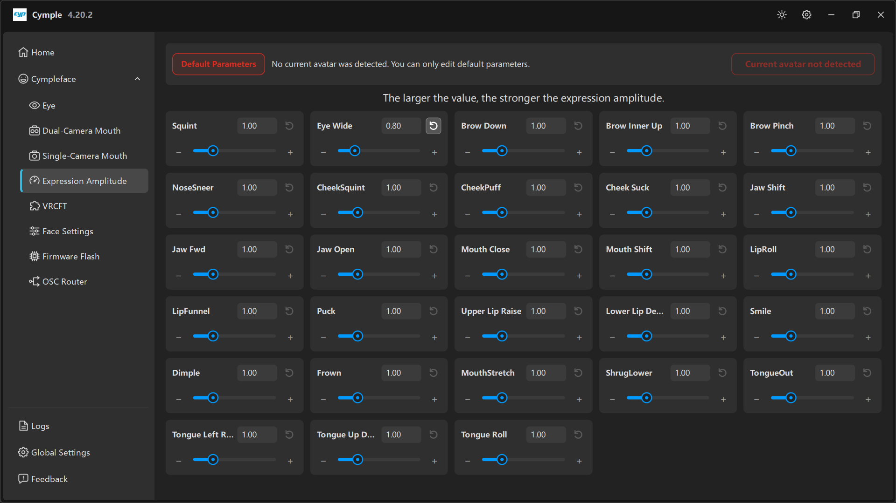

# Expression Amplitude

Сетка из 28 ползунков — по одному усилению на выражение. На этой странице проводят больше всего
времени, и её чаще всего понимают неправильно: она **не меняет трекинг**, она меняет амплитуду,
которую сообщает решатель.

## Баннер

Сверху: **Default Parameters** (красная обводка) и примечание

> *«Текущий аватар не обнаружен. Вы можете редактировать только параметры по умолчанию.»*

а справа — красная плашка: **Current avatar not detected**.

Как это читать:

| Состояние | Значение |
|---|---|
| Красная плашка, активен **Default Parameters** | VRChat не сообщил консоли, какой аватар загружен. Правки уходят в резервный профиль, который применяется к любому аватару |
| Красной плашки нет | VRChat сообщил аватар; теперь консоль редактирует профиль этого аватара |

Аватар определяется через OSC от VRChat. Если плашка не исчезает: включите OSC в VRChat, оставьте
**VRC Direct** включённым и проверьте **Input Rate** на [VRCFT](vrcft.md). Отсутствие аватара —
проблема связи VRChat → консоль, а не трекера.

Почему разделение важно: параметры привязаны к аватару. Чиби-аватару с большими глазами обычно нужно
другое усиление **Eye Wide**, чем реалистичному. Правка значений по умолчанию при загруженном
аватаре на этот аватар не влияет.

## Заголовок

> *«Чем больше значение, тем сильнее амплитуда выражения.»*

Каждый ползунок по умолчанию равен `1.00` и регулируется от `0` (выражение подавлено) вверх. В
каждой карточке есть:

| Элемент | Назначение |
|---|---|
| Поле значения | Введите точное значение; стрелки меняют его пошагово |
| Кнопка ⟲ | Сбрасывает это выражение к `1.00` |
| **−** / **+** | Грубая подстройка |
| Ползунок | Быстрый нелинейный поиск перетаскиванием |

## 28 выражений

В порядке сетки консоли:

| Ряд | Выражения |
|---|---|
| 1 | **Squint**, **Eye Wide**, **Brow Down**, **Brow Inner Up**, **Brow Pinch** |
| 2 | **NoseSneer**, **CheekSquint**, **CheekPuff**, **Cheek Suck**, **Jaw Shift** |
| 3 | **Jaw Fwd**, **Jaw Open**, **Mouth Close**, **Mouth Shift**, **LipRoll** |
| 4 | **LipFunnel**, **Puck**, **Upper Lip Raise**, **Lower Lip De…** (depress), **Smile** |
| 5 | **Dimple**, **Frown**, **MouthStretch**, **ShrugLower**, **TongueOut** |
| 6 | **Tongue Left R…** (roll), **Tongue Up D…**, **Tongue Roll** |

Имена — это блендшейпы конкретного аватара в VRChat. Ваш аватар должен предоставлять те же имена
параметров, иначе значение просто отбрасывается — см. [Настройку VRChat](../guides/vrchat-setup.md).

## Метод настройки, который сходится

Не настраивайте 28 ползунков на глаз. Используйте такой цикл для каждого выражения:

1. **Выставьте всё остальное в `1.00`.** Чистая отправная точка делает изменение одной переменной
   осмысленным.
2. **Вызовите выражение на полную** — широкая улыбка, сильное прищуривание, высунутый язык.
3. **Сравните с реальностью** в зеркале или через камеру VRChat.
4. **Подстройте один ползунок**, затем повторите вызов трижды, чтобы проверить повторяемость.
5. **Проверьте лицо в покое.** Многие аватары получают постоянное прищуривание, потому что `Squint`
   поднимали в попытке компенсировать слабый трекер.

Признаки слишком большого значения: выражения срываются в максимум, лицо выглядит преувеличенным, а
соседние формы «протекают» друг в друга (например, `Smile` тянет за собой `CheekSquint`).

## Подсказки по выражениям

| Выражение | Поднимать, когда | На что смотреть |
|---|---|---|
| **Squint** | Прищуривание почти не видно | Постоянное прищуривание в покое |
| **Eye Wide** | Удивление выглядит плоским | Глаза проваливаются сквозь веки |
| **Brow Down / Inner Up / Pinch** | Брови выглядят застывшими | Дрожание бровей, влияние на веки |
| **NoseSneer** | Отвращение не видно (частый случай) | Посторонние движения носа |
| **CheekSquint / CheekPuff / Cheek Suck** | Щёки не реагируют | Моносборки: слабый сигнал, не переусердствуйте |
| **Jaw Fwd / Jaw Shift** | Жевание, угол челюсти | Сильно на стерео, слабо на моно |
| **Jaw Open** | Рот почти не открывается | Переоткрытие, обрезка подбородка |
| **Mouth Close** | Губы остаются приоткрытыми | Борьба с **Jaw Open** |
| **Mouth Shift** | Асимметрия рта | Уход в сторону |
| **LipRoll** | Подворот губы не виден | — |
| **LipFunnel / Puck** | Слабо видны формы поцелуя и свиста | Взаимное влияние этих двух |
| **Upper Lip Raise / Lower Lip Depress** | Оскал и зубы | Преувеличенное обнажение дёсен |
| **Smile / Dimple / Frown** | Эмоция выглядит плоской | Улыбка «протекает» в щёки |
| **MouthStretch / ShrugLower** | Не хватает форм напряжения | — |
| **TongueOut / Tongue Left / Tongue Up / Tongue Roll** | Языка не видно | Детекция шумная; действуйте мягко |

## Взаимодействие со страницей Eye

Два усиления для одного и того же эффекта существуют намеренно:

- **Blink Close Amplitude** на странице [Eye](eye.md) управляет тем, насколько легко закрываются
  *веки*.
- **Squint** здесь управляет *выражением*, а не веком.

Если глаза не закрываются, сначала поправьте [Eye](eye.md) → **Blink Close Amplitude**; повышение
`Squint` здесь не поможет и только исказит лицо.

## Сохранение

Изменения применяются сразу и сохраняются в `%LOCALAPPDATA%\Cymple\iniFile.ini`. Кнопки сохранения
нет; отмены тоже нет, поэтому перед крупной правкой запишите старое значение (сброс ⟲ действует по
одному ползунку).

---

**Далее:** [VRCFT](vrcft.md) · [Настройка VRChat](../guides/vrchat-setup.md)

[English version](../../en/software/expression-amplitude.md) · Русский · ИИ-перевод: DeepSeek-V4.1--Flash
