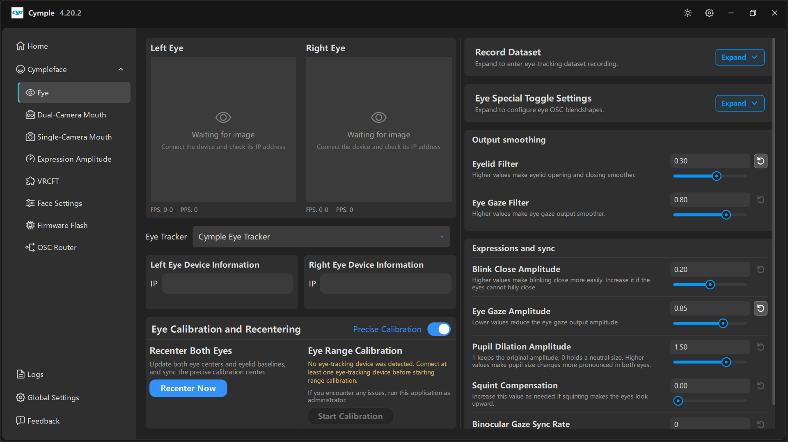

# Eye

Самая насыщенная страница консоли: слева вход с устройств, в центре калибровка, справа — все
параметры вывода, связанные со взглядом.

## Раскладка

| Колонка | Содержимое |
|---|---|
| Слева | Предпросмотры **Left Eye** / **Right Eye**, счётчики **FPS** / **PPS** |
| В центре | Селектор **Eye Tracker**, **Left/Right Eye Device Information**, **Eye Calibration and Recentering** |
| Справа | **Record Dataset**, **Eye Special Toggle Settings**, **Output smoothing**, **Expressions and sync** |

## Предпросмотры камер

На каждой карточке — живое изображение или пунктирная заглушка с надписями *"Waiting for image"* и
*"Connect the device and check its IP address"*.

| Счётчик | Значение | Норма |
|---|---|---|
| **FPS** | Кадры в секунду, полученные с этой камеры | 25–30 на 5 ГГц |
| **PPS** | Обработанных отсчётов в секунду — кадры, которые решатель действительно принял | Близко к FPS |

**FPS высокий, PPS низкий** — кадры приходят, но детектор зрачка их отбраковывает: направление,
фокус или освещение. **Оба нулевые** — проблема в сети, переходите к разделу
[Настройка сети](../hardware/network.md).

## Eye Tracker

Выпадающий список выбора бэкенда отслеживания. `Cymple Eye Tracker` — родной драйвер для двух
камер. Другие пункты появляются, когда установлены дополнительные бэкенды; оставьте значение по
умолчанию, если только вы намеренно не смешиваете разное железо.

## Информация об устройстве

Два текстовых поля, по одному на глаз:

| Поле | Ввод |
|---|---|
| **Left Eye Device Information → IP** | IP левой камеры, например `192.168.1.201` |
| **Right Eye Device Information → IP** | IP правой камеры, например `192.168.1.202` |

Для бинокулярного отслеживания нужны оба адреса. С одной камерой консоль работает монокулярно:
взглядом пользоваться можно, а вот стереоглубины и симметрии зрачков не будет.

## Eye Calibration and Recentering

### Precise Calibration

Переключатель в правом верхнем углу панели. Когда он включён, калибровка считается дольше, но центр
получается точнее. Включайте, когда крепление уже окончательное; пока вы ещё двигаете камеры,
держите его выключенным.

### Recenter Both Eyes

> *«Обновляет центры обоих глаз и базовые линии век, а также синхронизирует центр точной
> калибровки.»*

**Recenter Now** заново задаёт нейтральное положение. Выполняйте её в надетом шлеме и со взглядом
прямо перед собой.

Перецентровка нужна, когда:

- вы надели шлем,
- шлем сдвинулся на лице,
- через некоторое время взгляд уходит в сторону,
- вы заметно изменили **Eye Gaze Amplitude**.

Операция занимает секунду и снимает большинство жалоб в духе «взгляд залип влево».

### Eye Range Calibration

> *"No eye-tracking device was detected. Connect at least one eye-tracking device before starting
> range calibration."*
>
> *"If you encounter any issues, run this application as administrator."*

**Start Calibration** размечает весь диапазон движений глаз: вы следите за девятью целями, и
консоль запоминает крайние положения, чтобы саккады не обрезались. Кнопка недоступна, пока хотя бы
одно устройство для глаз не передаёт поток, — об этом и говорят сообщения выше.

Правила хорошей диапазонной калибровки:

1. Сядьте так, как будете играть на самом деле; не наклоняйтесь вперёд.
2. Держите голову неподвижно и двигайте только глазами.
3. Задерживайте взгляд на каждой цели, пока она не сменится.
4. Повторите, если какая-то цель была пропущена: неполная калибровка проявляется тем, что взгляд
   насыщается по краям.

## Record Dataset

*«Разверните, чтобы перейти к записи датасета отслеживания взгляда.»*

Свёрнута по умолчанию. В развёрнутом виде записывает размеченные кадры для обучения или дообучения.
О процессе, затратах на хранение и приватности см. [Запись датасета](../guides/dataset-recording.md).

## Eye Special Toggle Settings

*«Разверните, чтобы настроить OSC-блендшейпы глаз.»*

Свёрнута по умолчанию. Здесь собраны переключатели, которые решают, какие OSC-параметры, связанные
с глазами, отправляются, — так можно подавить формы, которые ваш аватар не использует.

## Output smoothing

Два временных фильтра. Больше значение — плавнее и с задержкой; меньше — резче и шумнее.

| Параметр | По умолчанию | Подсказка |
|---|---|---|
| **Eyelid Filter** | `0.30` | *«Большие значения делают открытие и закрытие век плавнее.»* |
| **Eye Gaze Filter** | `0.80` | *«Большие значения делают вывод взгляда плавнее.»* |

Советы по настройке:

- Мигание «дребезжит» (в покое глаза полуприкрыты) → поднимите **Eyelid Filter** до `0.4`–`0.5`.
- Взгляд дрожит при чтении → **Eye Gaze Filter** `0.85`–`0.9`.
- Взгляд запаздывает на быстрых саккадах → снизьте **Eye Gaze Filter** к `0.7` и полагайтесь на
  более точную калибровку, а не на сглаживание.

## Expressions and sync

| Параметр | По умолчанию | Подсказка и смысл |
|---|---|---|
| **Blink Close Amplitude** | `0.20` | *«Большие значения облегчают закрывание глаз при мигании. Увеличьте, если глаза не закрываются полностью.»* |
| **Eye Gaze Amplitude** | `0.85` | *«Меньшие значения уменьшают амплитуду вывода взгляда.»* — общее усиление взгляда |
| **Pupil Dilation Amplitude** | `1.50` | *«1 сохраняет исходную амплитуду, 0 удерживает нейтральный размер. Большие значения делают изменение размера зрачка заметнее на обоих глазах.»* |
| **Squint Compensation** | `0.00` | *«Увеличивайте это значение по необходимости, если при прищуривании глаза смотрят вверх.»* |
| **Binocular Gaze Sync Rate** | `0` | Связывает вывод двух глаз; увеличьте, если глаза заметно рассогласуются, ценой части независимости |

Стартовые значения, которые подходят большинству аватаров: оставьте значения по умолчанию, меняйте
по одному и после каждой правки проверяйте четыре крайних положения — глаза открыты, глаза закрыты,
взгляд максимально влево, взгляд максимально вправо.

## Частые проблемы на этой странице

| Симптом | Что делать |
|---|---|
| *"Waiting for image"* на одном глазу | Неверный IP, камера офлайн или изоляция клиентов на точке доступа — см. [Настройку сети](../hardware/network.md) |
| Предпросмотр чёрный, но FPS > 0 | Закрыта крышка, сбита экспозиция или камера упёрлась в линзу |
| **Start Calibration** неактивна | Устройство не обнаружено; сначала почините IP и предпросмотр |
| Взгляд верный, но веки всегда полуприкрыты | Слишком мал **Blink Close Amplitude** или устарела базовая линия век → **Recenter Now** |
| Взгляд насыщается по краям экрана | Диапазонная калибровка неполная или слишком велик **Eye Gaze Amplitude** |

---

**Далее:** [Dual-Camera Mouth](dual-camera-mouth.md) · [Руководство по калибровке](../guides/calibration.md)

[English version](../../en/software/eye.md) · Русский · ИИ-перевод: DeepSeek-V4.1--Flash
