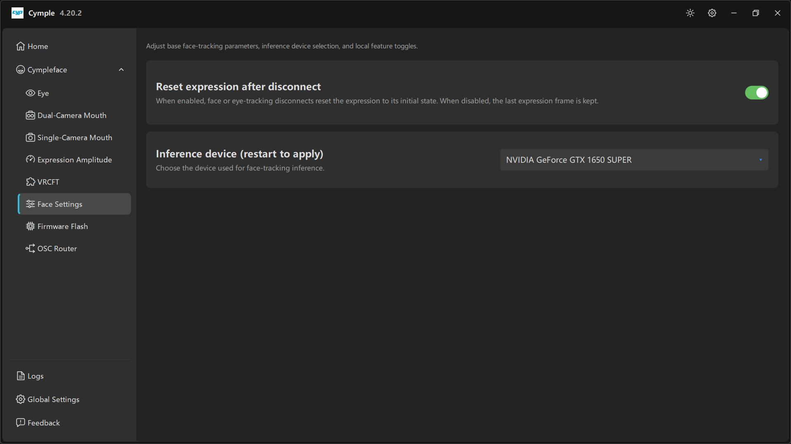

# Face Settings

*«Настройка базовых параметров отслеживания мимики, выбор устройства для инференса и локальных
переключателей функций.»*

Два параметра, и оба с непропорционально большим эффектом.

## Reset expression after disconnect

| Свойство | Значение |
|---|---|
| По умолчанию | **On** |
| Подсказка | *«Когда параметр включён, обрыв связи с трекером мимики или взгляда сбрасывает выражение в исходное состояние. Когда выключен, последний кадр выражения сохраняется.»* |

| Состояние | Поведение | Когда выбирать |
|---|---|---|
| **On** | При обрыве аватар возвращается в нейтральное выражение | Обычная работа — потерянный пакет не должен замораживать крик на лице |
| **Off** | Последний рассчитанный кадр удерживается бесконечно | Осознанно: сохранить позу на время короткого сбоя или понять, действительно ли данные прекратились |

Та же настройка доступна сторонним потребителям как
`[Cymple_Mouth] reset_expression_on_tracking_disconnect` в файле конфигурации, который модуль VRCFT
читает раз в секунду. См. [Файл конфигурации](../reference/config.md).

> Если параметр **выключен**, настоящий обрыв выглядит как застывшее лицо, а не нейтральное. Если вы
> разбираетесь с ситуацией «аватар перестал двигаться», включите его обратно: нейтральное лицо
> гораздо легче распознать как отказ.

## Inference device (restart to apply)

| Свойство | Значение |
|---|---|
| Подсказка | *«Выберите устройство, используемое для инференса при отслеживании мимики.»* |
| Пример значения | `NVIDIA GeForce GTX 1650 SUPER` |
| Нужен перезапуск | **Да** — так буквально и написано в подписи |

Выпадающий список содержит вычислительные устройства, найденные консолью при запуске. Обычно это:

- по одной записи на каждую видеокарту NVIDIA с поддержкой CUDA,
- запись встроенной видеокарты, если она есть,
- резервный вариант на CPU.

### Как выбирать

| Ситуация | Что выбрать |
|---|---|
| Одна видеокарта NVIDIA | Её — это всегда самый быстрый вариант |
| NVIDIA + встроенная видеокарта | Карту NVIDIA и убедитесь, что шлем и SteamVR работают на той же видеокарте |
| Только AMD или Intel | CPU или встроенное устройство; ожидайте меньший FPS и большую нагрузку на CPU |
| Несколько видеокарт NVIDIA | Ту, к которой подключён шлем |

### Почему нужен перезапуск

Движок инференса выделяет свой контекст на выбранном устройстве при старте процесса. Переключение на
лету означало бы разрушить и заново собрать модель, поэтому консоль предлагает перезапуск.
Достаточно перезапустить консоль — SteamVR и VRChat можно оставить открытыми.

### Как проверить, что выбор применился

1. Перезапустите консоль.
2. Откройте [Logs](logs.md) и найдите баннер с устройством в начале сессии.
3. Откройте [Eye](eye.md) или страницу трекера мимики и убедитесь, что `FPS`/`PPS` в норме.

Если запись видеокарты пропала после обновления драйвера, выберите её снова и перезапуститесь:
список заново строится по перечислению CUDA при каждом запуске.

## Взаимодействие с другими параметрами

- Медленное устройство инференса проявляется низким **PPS** при нормальном **FPS**: кадры приходят,
  обработка не успевает. Исправляйте устройство, а не сеть.
- На ноутбуке Windows может переключать видеокарты для каждого приложения. Задайте консоли режим
  «Высокая производительность» в разделе **Graphics settings**, чтобы она не оказалась на встроенной видеокарте.

---

**Далее:** [Firmware Flash](firmware-flash.md) · [Диагностика проблем](../reference/troubleshooting.md)

[English version](../../en/software/face-settings.md) · Русский · ИИ-перевод: DeepSeek-V4.1--Flash
