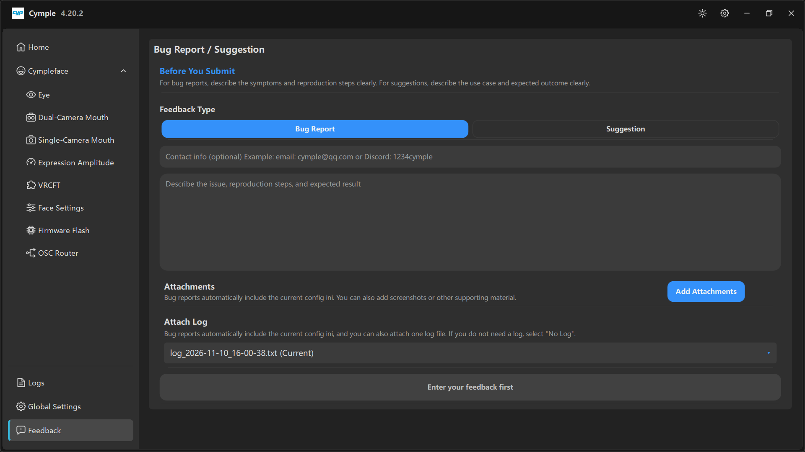

# Feedback

Форма отчёта внутри приложения. Она отправляет обращение в трекер сопровождающего и умеет
автоматически прикладывать файл конфигурации и один журнал — именно это делает отчёт пригодным для
работы.

## Заголовок

**Bug Report / Suggestion**

> **Before You Submit** — *«Для отчётов об ошибках чётко опишите симптомы и шаги воспроизведения.
> Для предложений чётко опишите сценарий использования и ожидаемый результат.»*

## Тип обращения

Две крупные кнопки-сегмента:

| Тип | Для чего |
|---|---|
| **Bug Report** (выбран по умолчанию) | Что-то сломано или работает неправильно |
| **Suggestion** | Запрос функции или улучшения |

## Контактные данные (необязательно)

> *«Контактные данные (необязательно). Пример: email: cymple@qq.com или Discord: 1234cymple»*

Оставьте поле пустым для анонимного отчёта. Заполните его, если хотите получить уточняющий вопрос.

## Описание

Большое поле свободного текста: *«Опишите проблему, шаги воспроизведения и ожидаемый результат»*.

Отчёт, который исправляют быстро, содержит:

1. **Что вы делали** — пронумерованные шаги, начиная с запуска консоли.
2. **Что ожидали** — одним предложением.
3. **Что произошло** — одним предложением, плюс точный текст любого сообщения.
4. **Аппаратуру** — айтрекер, трекер мимики (двухкамерный или однокамерный), самостоятельная сборка
   или комплект.
5. **Окружение** — шлем, видеокарта ПК, диапазон Wi-Fi, VRChat или отдельный инструмент.
6. **Версию** — скопируйте баннер из [Logs](logs.md).

Кнопка отправки недоступна, пока описание пустое; на нашем снимке экрана на ней написано
**Enter your feedback first**.

## Вложения

> *«К отчётам об ошибках автоматически прикладывается текущий ini-файл конфигурации. Вы также можете
> добавить снимки экрана или другие материалы.»*

**Add Attachments** открывает выбор файлов. Снимок проблемной страницы ценнее абзаца описания,
особенно когда речь о предпросмотре и калибровке.

## Прикрепить журнал

> *«К отчётам об ошибках автоматически прикладывается текущий ini-файл конфигурации, а ещё вы можете
> приложить один файл журнала. Если журнал не нужен, выберите „No Log“.»*

| Вариант | Значение |
|---|---|
| `log_…txt (Current)` | Журнал текущей сессии — правильный выбор для воспроизводимой ошибки |
| Более старый файл | Прошлая сессия; нужен, если ошибка случилась до перезапуска |
| **No Log** | Ничего не прикладывается; подходит для предложений и отчётов, где важна приватность |

## Что отправляется

| Пункт | Автоматически | Примечания |
|---|---|---|
| Описание | — | Ваш текст |
| Контактные данные | — | Только если вы их заполнили |
| INI-файл конфигурации | Да, для отчётов об ошибках | Содержит IP устройств и амплитуды по аватарам |
| Файл журнала | По желанию, один | Метки времени, версии, события подключения |
| Снимки экрана | По желанию | Файлы выбираете вы |

> **Приватность.** В файле конфигурации есть ваши локальные IP-адреса и имена параметров аватара.
> Если это для вас чувствительно, отправьте предложение или сократите описание и выберите **No Log**.

## Другие каналы

Проект принимает отчёты и вне приложения:

- issue на GitHub в вышестоящих репозиториях,
- Discord сообщества,
- группа в QQ, указанная в README репозитория.

Пользуйтесь тем каналом, по которому действительно будете отвечать. Отчёты из приложения несут
больше контекста автоматически.

---

**Далее:** [Logs](logs.md) · [Диагностика проблем](../reference/troubleshooting.md)

[English version](../../en/software/feedback.md) · Русский · ИИ-перевод: DeepSeek-V4.1--Flash
