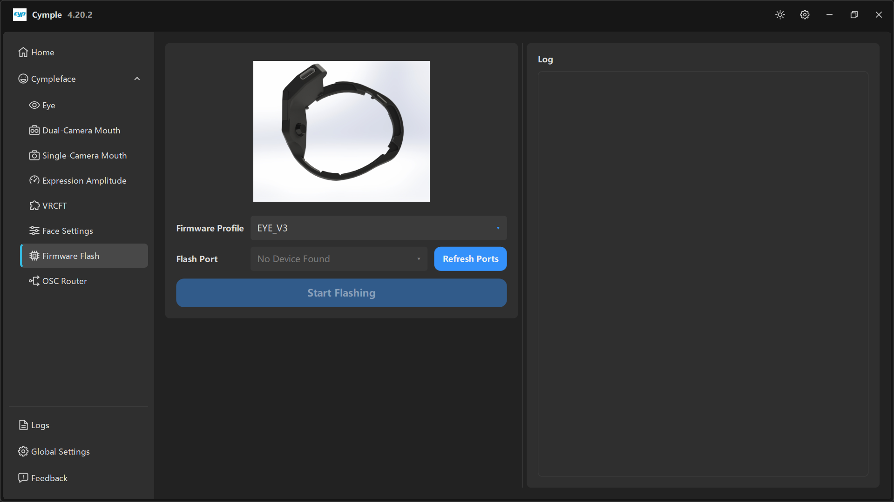

# Firmware Flash

Прошивальщик внутри приложения. Он заменяет Arduino IDE для повседневного обновления прошивки:
выберите профиль, укажите COM-порт, нажмите одну кнопку.

## Раскладка

| Колонка | Содержимое |
|---|---|
| Слева | Иллюстрация изделия, **Firmware Profile**, **Flash Port**, **Refresh Ports**, **Start Flashing** |
| Справа | Панель **Log** |

## Firmware Profile

*«Firmware Profile»* — сборка, которую нужно записать.

| Значение | Смысл |
|---|---|
| `EYE_V3` | Текущий профиль айтрекера. На нашем снимке экрана выбран именно он |
| Профили для мимики | Для плат трекера мимики, в однокамерном и двухкамерном вариантах |
| Профили комплектов | Для готовых трекеров и донглов |

> Профиль должен соответствовать физической плате. При неверном профиле прошивка обычно
> записывается успешно, а потом даёт поток, который консоль понимает неправильно, — худший вид
> отказа, потому что всё *выглядит* подключённым.

Если вы не уверены, какая у вас плата, посмотрите на корпус или шелкографию платы до прошивки и
выберите версию, которая была описана при сборке устройства.

## Flash Port

*«Flash Port»* — последовательный порт подключённой платы.

- Показывает **No Device Found**, когда совместимого USB-последовательного устройства нет.
- **Refresh Ports** выполняет повторное сканирование. Нажимайте её *после* подключения платы:
  список не обновляется сам.

Что проверить, если порт так и не появился:

1. **Кабель.** Многие USB-кабели только заряжают. Нужен кабель, по которому идут данные.
2. **Порт.** На настольном ПК предпочтите порт на задней панели, избегайте хабов без питания.
3. **Драйвер.** В диспетчере устройств должно быть COM-устройство — CH340, CP210x или FTDI — без
   предупреждающего треугольника.
4. **Загрузчик.** Зажмите **BOOT**, коротко нажмите **RST**, отпустите **BOOT**, затем нажмите
   **Refresh Ports**.
5. **Питание.** Только один источник питания: USB, а не USB *и* шлем одновременно.

## Start Flashing

Широкая кнопка. Ход процесса и ошибки появляются на панели **Log** справа.

| Что в журнале | Смысл |
|---|---|
| Строка о завершении, ошибок нет | Прошивка записана; передёрните питание платы |
| `Failed to connect` или тайм-аут | Плата не в режиме загрузчика, неверный порт или плохой кабель |
| Ошибка записи на конкретном смещении | Несовпадение размера флеш-памяти или повреждённый бинарник — скачайте релиз заново |

Пока идёт запись, не отключайте кабель, не нажимайте кнопки и не закрывайте консоль. Прерванная
прошивка обычно восстанавливается повторной записью в режиме загрузчика, но иногда требует полного
стирания.

## Панель Log

Правая сторона. Моноширинный шрифт, прокрутка. Здесь те же сообщения, которые выдаёт библиотека
прошивки, поэтому именно эта панель — достоверный источник, когда кажется, что кнопка ничего не
делает.

> Панель журнала здесь — *не* то же самое, что [Logs](logs.md). Она показывает только вывод
> прошивальщика; страница Logs показывает весь сеанс работы приложения.

## После успешной прошивки

1. Передёрните питание платы.
2. Проверьте её IP заново — обновление прошивки может сбросить статический адрес.
3. Обновите IP на странице [Eye](eye.md) или на странице трекера мимики.
4. Пройдите [Калибровку](../guides/calibration.md) заново: значения экспозиции по умолчанию могли
   измениться.

## См. также

- [Прошивка](../hardware/firmware.md) — профили, восстановление, смещения прошивки ESP32.
- [Настройка сети](../hardware/network.md) — если устройство недоступно после прошивки.

---

**Далее:** [OSC Router](osc-router.md) · [Logs](logs.md)

[English version](../../en/software/firmware-flash.md) · Русский · ИИ-перевод: DeepSeek-V4.1--Flash
