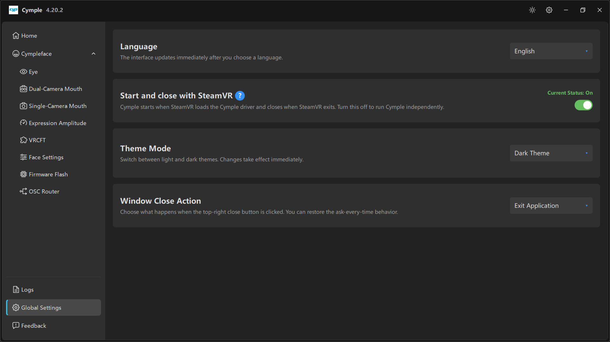

# Global Settings



Четыре настройки уровня приложения. Ни одна из них не влияет на качество отслеживания, но все четыре
влияют на то, как консоль ведёт себя изо дня в день.

## Language

*«Интерфейс обновляется сразу после выбора языка.»*

| Свойство | Значение |
|---|---|
| По умолчанию | `English` |
| Применяется | Мгновенно, без перезапуска |
| Область действия | Только интерфейс — журналы, ключи конфигурации и параметры аватара остаются английскими |

Если после смены языка часть подписей осталась на английском, значит эти строки в вашей сборке ещё
не переведены; настройка честно отвечает только за то, что охватывает.

## Start and close with SteamVR

*«Cymple запускается, когда SteamVR загружает драйвер Cymple, и закрывается при выходе из SteamVR.
Выключите параметр, чтобы запускать Cymple отдельно.»* — **Current Status: On**

| Состояние | Поведение | Когда использовать |
|---|---|---|
| **On** | Время жизни консоли следует за SteamVR | Обычная работа в VR — вам не нужно запускать два приложения |
| **Off** | Консоль запускаете и останавливаете вы сами | Отладка или работа с консолью без VR |

Именно так консоль и драйвер OpenVR остаются синхронизированными. Если выключить параметр, помните:
теперь SteamVR может запуститься без консоли, и драйверу будет неоткуда брать данные.

Ссылки по типичным проблемам:

- Консоль сразу закрывается при запуске SteamVR → папка драйвера повреждена или продублирована.
- Консоль не запускается вместе со SteamVR → драйвер не загружен; см. [Установку](../getting-started/installation.md).
- Консоль закрывается и вы теряете состояние калибровки → откалибруйте заново — перецентровка занимает секунды.

## Theme Mode

*«Переключение между светлой и тёмной темой. Изменения применяются сразу.»*

| Вариант | Примечания |
|---|---|
| `Dark Theme` | По умолчанию в наших снимках экрана; глазам легче рядом с ярким шлемом |
| `Light Theme` | Лучше при дневном свете; некоторые скриншоты в сторонних руководствах сделаны в светлой теме |

Значок солнца в заголовке окна переключает ту же настройку.

## Window Close Action

*«Выберите, что происходит при нажатии кнопки закрытия в правом верхнем углу. Поведение
„спрашивать каждый раз“ можно вернуть.»*

| Вариант | Поведение |
|---|---|
| `Exit Application` | Закрывает консоль (а вместе с ней и отслеживание) |
| Свернуть в трей (зависит от сборки) | Отслеживание продолжает работать, окно скрыто |
| Спрашивать каждый раз | При каждом закрытии показывается вопрос |

Если закрытие окна молча убивает отслеживание посреди сессии, менять нужно именно эту настройку:
выберите сворачивание в трей или примите, что закрытие консоли намеренно останавливает отслеживание.

## Где всё это хранится

Все четыре настройки лежат в файле конфигурации:

```ini
[Global]
language=English
start_with_steamvr=1
theme=dark
close_action=exit
```

Имена ключей меняются от релиза к релизу; о том, как посмотреть настоящий файл, а не угадывать, см.
[Файл конфигурации](../reference/config.md).

---

**Далее:** [Feedback](feedback.md) · [Файл конфигурации](../reference/config.md)

<sub>[English version](../../en/software/global-settings.md) · Русский · ИИ-перевод: DeepSeek-V4.1--Flash</sub>
