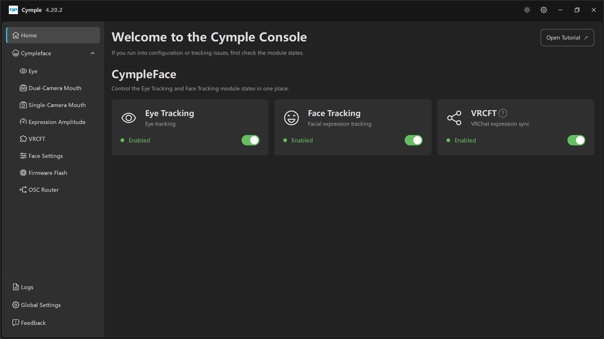

# Home

Стартовая страница. Она нужна, чтобы ответить на один вопрос до того, как вы начнёте искать причину
неполадки: *включены ли модули на самом деле?*

## Заголовок

| Элемент | Значение |
|---|---|
| **Welcome to the Cymple Console** | Статичный заголовок |
| *«Если возникли проблемы с конфигурацией или трекингом, сначала проверьте состояния модулей.»* | Совет от самой консоли, и он верен чаще, чем кажется |
| **Open Tutorial ↗** | Открывает онлайн-руководство в браузере |

## CympleFace

*«Управляйте состояниями модулей Eye Tracking и Face Tracking в одном месте.»*

Три карточки, у каждой — значок, название, подзаголовок в одну строку, плашка состояния и
переключатель:

| Карточка | Подзаголовок | Что включает переключатель |
|---|---|---|
| **Eye Tracking** | *Отслеживание взгляда* | Конвейер взгляда, зрачка и век |
| **Face Tracking** | *Отслеживание мимики* | Решатель рта и выражений, включая данные век |
| **VRCFT** | *Синхронизация выражений VRChat* | Выходной каскад OSC/VRCFT |

| Плашка | Значение |
|---|---|
| 🟢 **Enabled** | Модуль инициализирован и работает |
| ⚪ *Disabled* | Модуль выключен; его страницы открываются, но предпросмотры остаются пустыми |

### Когда что-то стоит выключать

- **Eye Tracking off** — у вас только трекер мимики, или вы отлаживаете конвейер мимики и хотите
  убрать лишние переменные.
- **Face Tracking off** — у вас только отслеживание взгляда, или вы хотите снизить нагрузку на GPU.
  Учтите, что в некоторых сборках веки считает решатель мимики; отключив его, вы можете потерять
  данные `Blink`.
- **VRCFT off** — вы отправляете данные через внешний экземпляр VRCFaceTracking вместо VRC Direct
  или хотите остановить вывод на время калибровки.

### «Выключено» — не то же самое, что «подключено»

Зелёная плашка **Enabled** означает, что *подсистема работает*, а не то, что *устройство подключено*.
Трекер может быть включён и при этом показывать ноль устройств — проверьте страницы устройств
([Eye](eye.md), [Dual-Camera Mouth](dual-camera-mouth.md), [Single-Camera Mouth](single-camera-mouth.md))
и счётчики `FPS`/`PPS`.

## Порядок поиска неисправности

1. Все три плашки на Home зелёные.
2. На странице устройства есть живой предпросмотр и ненулевой `FPS`.
3. На [VRCFT](vrcft.md) ненулевые **Input Rate** / **Output Rate**.
4. Аватар реагирует в VRChat, OSC включён в игре.

Если не выполняется шаг 1, всё остальное работать не может — именно поэтому консоль ставит эту
страницу первой.

---

**Далее:** [Eye](eye.md) · [VRCFT](vrcft.md)

[English version](../../en/software/home.md) · Русский · ИИ-перевод: DeepSeek-V4.1--Flash
