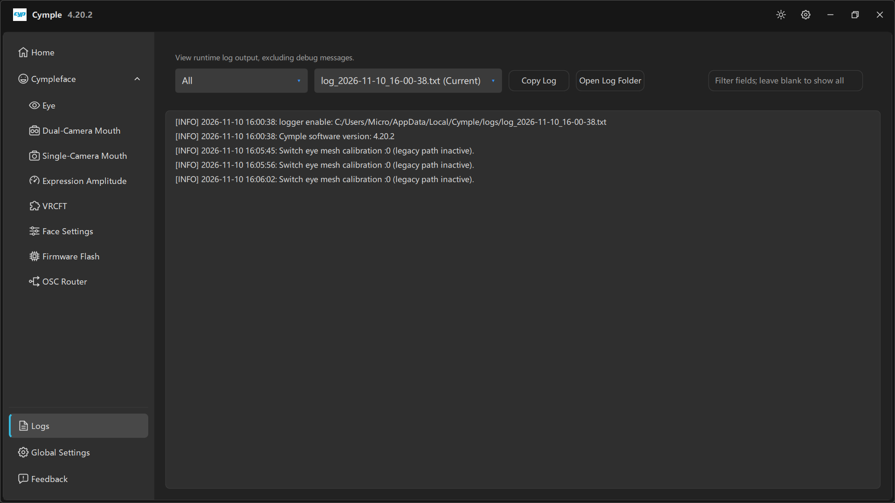

# Logs



*«Просмотр журнала работы без отладочных сообщений.»*

Страница журнала — первое место, куда стоит смотреть, когда что-то не так, и последнее, куда обычно
смотрят. Здесь тот же текст, что пишется на диск, но без отладочного шума.

## Элементы управления

| Элемент | Назначение |
|---|---|
| Выпадающий список уровня (**All**) | Фильтр по важности: все, информационные, предупреждения, ошибки |
| Выпадающий список файлов | `<log file> (Current)` для текущей сессии, более старые файлы — для прошлых запусков |
| **Copy Log** | Копирует видимый журнал в буфер обмена — самый быстрый способ приложить его к отчёту |
| **Open Log Folder** | Открывает `%LOCALAPPDATA%\Cymple\logs\` в Проводнике |
| Поле фильтра | *«Фильтр по полям, оставьте пустым, чтобы показать всё»* — поиск подстроки по строкам журнала |

## Как выглядит здоровая сессия

```text
[INFO] 2026-11-10 16:00:38: logger enable: C:/Users/<user>/AppData/Local/Cymple/logs/log_2026-11-10_16-00-38.txt
[INFO] 2026-11-10 16:00:38: Cymple software version: 4.20.2
[INFO] 2026-11-10 16:05:45: Switch eye mesh calibration :0 (legacy path inactive).
```

| Строка | Почему она важна |
|---|---|
| `logger enable: …` | Где лежит журнал этой сессии — полезно, когда пользователь присылает не тот файл |
| `Cymple software version: …` | Достоверная версия; заголовок окна может отставать от подменённой на лету сборки |
| `Switch eye mesh calibration :0 (legacy path inactive).` | Переключение режима калибровки. `legacy path inactive` — норма для текущих сборок |

Работающий конвейер **молчит**: устройство подключается один раз, калибровка объявляется один раз, а
дальше ничего не происходит, пока вы что-нибудь не измените. Журнал, который непрерывно
прокручивается, — это устройство, переподключающееся по кругу.

## Как читать сбои

| Что в журнале | Как понимать |
|---|---|
| Повторяющиеся попытки подключения к одному IP | Камера недоступна — проблема в сети, а не в консоли |
| `Switch eye mesh calibration` повторяется | Калибровка запускается снова и снова, возможно из-за горячей клавиши или цикла в интерфейсе |
| Трассировки стека / `Exception` | Сбой на стороне консоли; сохраните журнал и сообщите о нём |
| После баннера версии вообще ничего | Модули выключены на [Home](home.md) или консоль простаивает по своей логике |

## Файлы журнала на диске

| Свойство | Значение |
|---|---|
| Папка | `%LOCALAPPDATA%\Cymple\logs\` |
| Имя | `log_YYYY-MM-DD_HH-MM-SS.txt` |
| Срок жизни | Один файл на сессию; старые файлы хранятся, пока вы их не удалите |
| Кодировка | Текст UTF-8, одна строка с меткой времени на событие |

Хранение ручное — автоматической очистки нет. Если вы часто отправляете отчёты об ошибках,
периодически очищайте папку, чтобы выпадающий список файлов оставался удобным.

## Как правильно сообщить об ошибке

1. Воспроизведите проблему один раз на только что запущенной консоли.
2. Откройте **Logs** и выберите текущий файл.
3. Нажмите **Copy Log**.
4. Откройте [Feedback](feedback.md), опишите симптомы и шаги воспроизведения, приложите журнал там и
   укажите версию из баннера.

Полный шаблон отчёта см. в разделе [Feedback](feedback.md).

---

**Далее:** [Global Settings](global-settings.md) · [Feedback](feedback.md)

<sub>[English version](../../en/software/logs.md) · Русский · ИИ-перевод: DeepSeek-V4.1--Flash</sub>
