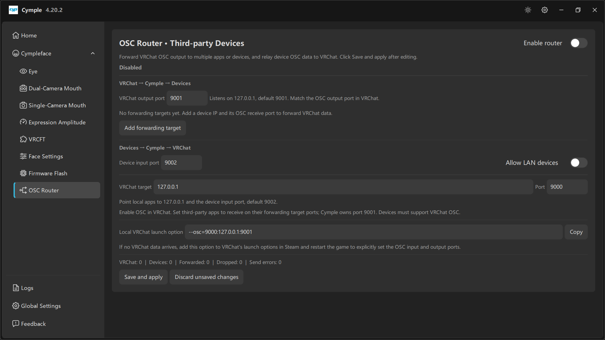

# OSC Router



Маршрутизатор превращает консоль в OSC-концентратор. Он умеет отправлять параметры VRChat в другие
приложения и на другие устройства, а также подавать данные от этих устройств обратно в VRChat.

Это единственная страница консоли с явной кнопкой **Save and apply**: правки накапливаются, пока вы
их не примените.

## Заголовок

**OSC Router · Third-party Devices** — *«Пересылайте OSC-вывод VRCHat в несколько приложений или на
устройства и передавайте OSC-данные устройств в VRCHat. После правок нажмите Save and apply.»*

Справа сверху: переключатель **Enable router**. Пока он выключен, в заголовке раздела написано
**Disabled**, и ничего не пересылается и не передаётся.

## VRCHat → Cymple → Devices

Данные, уходящие из VRChat: консоль их перехватывает и размножает.

| Поле | По умолчанию | Примечания |
|---|---|---|
| **VRCHat output port** | `9001` | *«Слушает на 127.0.0.1, по умолчанию 9001. Должен совпадать с портом вывода OSC в VRCHat.»* |

### Forwarding targets

*«Целей пересылки пока нет. Добавьте IP устройства и порт приёма OSC, чтобы пересылать данные
VRCHat.»*

**Add forwarding target** добавляет строку. В каждой строке задаются:

- **device IP** — принимающее приложение или устройство,
- **OSC receive port** — порт, на котором это приложение слушает.

Варианты использования:

| Цель | Обычный порт | Зачем |
|---|---|---|
| Приложение на телефоне, показывающее параметры аватара | собственный порт приложения | Отображение параметров VRChat |
| Второй ПК с OSC-инструментом | порт этого инструмента | Отладка или ведение журнала |
| Устройство тактильной отдачи или аксессуар | порт производителя | Реакция на выражения |

> Добавление цели не «съедает» вывод VRChat: консоль слушает один раз и повторяет данные каждой
> цели, поэтому VRChat продолжает отправлять на один адрес.

## Devices → Cymple → VRCHat

Данные в обратную сторону: от устройств и библиотек в VRChat.

| Поле | По умолчанию | Примечания |
|---|---|---|
| **Device input port** | `9002` | Куда локальные приложения должны отправлять OSC, предназначенный для VRChat |
| **Allow LAN devices** | Выключено | *Выключено* — только loopback; *включено* — приём с других хостов локальной сети |
| **VRCHat target** | `127.0.0.1` | Где слушает VRChat |
| **Port** | `9000` | Порт приёма VRChat |

> *«Направляйте локальные приложения на 127.0.0.1 и порт ввода устройств, по умолчанию 9002.
> Включите OSC в VRCHat. Сторонние приложения должны принимать данные на портах своих целей
> пересылки; порт 9001 принадлежит Cymple. Устройства должны поддерживать VRCHat OSC.»*

Два следствия, которые стоит запомнить:

1. **Порт 9001 принадлежит Cymple.** Любое другое приложение, которому нужен вывод VRChat, должно
   получать его через цель пересылки, а не занимать 9001 самостоятельно.
2. **`Allow LAN devices` — переключатель безопасности.** Он открывает маршрутизатор в вашу сеть.
   На общем Wi-Fi держите его выключенным.

## Local VRCHat launch option

```text
--osc=9000:127.0.0.1:9001
```

Рядом есть кнопка **Copy**.

> *«Если данные от VRCHat не приходят, добавьте этот параметр в параметры запуска VRCHat в Steam и
> перезапустите игру, чтобы явно задать порты ввода и вывода OSC.»*

Как читать параметр: VRChat слушает `9000` и отправляет на `127.0.0.1:9001` — ровно та пара, которую
ждёт консоль. Задаётся в Steam: **VRChat → Properties → General → Launch Options**.

## Statistics

```text
VRCHat: 0 | Devices: 0 | Forwarded: 0 | Dropped: 0 | Send errors: 0
```

| Счётчик | Значение | Если он остаётся нулевым |
|---|---|---|
| **VRCHat** | Сообщений, полученных от VRChat | OSC выключен в игре, неверный порт, маршрутизатор отключён |
| **Devices** | Сообщений, полученных от устройств и приложений | Никто не отправляет на 9002 или устройства локальной сети заблокированы |
| **Forwarded** | Сообщений, успешно переотправленных | Не настроено ни одной цели пересылки |
| **Dropped** | Сообщений, отброшенных (очередь или проверка) | Слишком высокая частота; уменьшите число целей или поток |
| **Send errors** | Неудачных отправок | Неверный IP или порт цели, цель недоступна |

Растущий **Dropped** при неизменном **Forwarded** обычно означает, что в списке есть мёртвая цель.

## Семантика сохранения

| Действие | Эффект |
|---|---|
| **Save and apply** | Записывает настройки и сразу запускает маршрутизацию |
| **Discard unsaved changes** | Возвращает страницу к последнему сохранённому состоянию |
| Уход со страницы без сохранения | Правки теряются; маршрутизация продолжает работать со старой конфигурацией |

Переключатель **Enable router** тоже подчиняется этой логике: сам по себе он ничего не меняет, пока
изменения не применены.

## Рецепты

**Монитор параметров на телефоне**

1. Включите **Enable router**.
2. Добавьте цель пересылки с IP телефона и портом приложения.
3. Нажмите Save and apply. VRChat по-прежнему общается только с консолью.

**Второе приложение, которому нужны параметры VRChat**

Всё то же самое, плюс ещё одна строка цели. Оба получают одинаковые данные.

**Передача OSC от устройства в VRChat**

1. Настройте устройство на отправку на `127.0.0.1:9002`.
2. Оставьте **VRCHat target** равным `127.0.0.1:9000`.
3. Нажмите Save and apply, затем убедитесь, что счётчик **Devices** растёт.

---

**Далее:** [Logs](logs.md) · [Порты и адреса](../reference/ports.md)

<sub>[English version](../../en/software/osc-router.md) · Русский · ИИ-перевод: DeepSeek-V4.1--Flash</sub>
