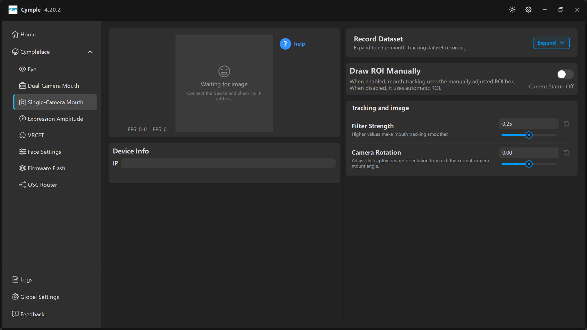

# Single-Camera Mouth

Страница монокулярного трекера мимики. Элементов меньше, чем на стереостранице: одно изображение,
один IP, один поворот и один фильтр — плюс переключатель **Draw ROI Manually**, который важнее всего
тогда, когда автоматическое отслеживание не справляется.

## Раскладка

| Колонка | Содержимое |
|---|---|
| Слева | Один предпросмотр **image**, **FPS**/**PPS**, кнопка **help**, **Device Info** |
| Справа | **Record Dataset**, **Draw ROI Manually**, **Tracking and image** |

## Предпросмотр

Пунктирная заглушка с надписями *"Waiting for image"* и *"Connect the device and check its IP
address"* означает, что потока нет. После подключения:

| Счётчик | Значение |
|---|---|
| **FPS** | Кадров в секунду с камеры |
| **PPS** | Обработанных отсчётов в секунду |

## Help

Синяя кнопка **? help** в углу предпросмотра открывает контекстную справку по этой странице — это
первое место, где стоит искать точные подсказки для текущей сборки: их обновляют чаще, чем эту вики.

## Device Info

Одно поле **IP** для камеры.

## Record Dataset

*«Разверните, чтобы перейти к записи датасета отслеживания мимики.»*

Свёрнута по умолчанию. В развёрнутом виде записывает размеченные кадры. См.
[Запись датасета](../guides/dataset-recording.md).

## Draw ROI Manually

> *«Когда параметр включён, отслеживание мимики использует вручную выставленную рамку ROI. Когда
> выключен — автоматический ROI.»* — **Current Status: Off**

ROI (region of interest, область интереса) — прямоугольник, который решатель считает «ртом». В
автоматическом режиме он ищется на каждом кадре, в ручном — закрепляется.

| Режим | Когда использовать |
|---|---|
| **Off** (автоматический) | Обычные конфигурации: рамка следует за лицом и терпит сползание шлема |
| **On** (ручной) | Нестандартное кадрирование, очень близко стоящая камера, густая растительность на лице или шлем, на котором автоматика постоянно цепляется за нос |

При включении в предпросмотре появляется перемещаемая рамка. Держите уголки рта внутри рамки при
максимальной улыбке, но не делайте её настолько большой, чтобы в неё попадал подбородок.

> Ручной ROI **не** следует за шлемом. После любого изменения посадки перецентруйте или перерисуйте
> рамку.

## Tracking and image

| Параметр | По умолчанию | Подсказка |
|---|---|---|
| **Filter Strength** | `0.25` | *«Большие значения делают отслеживание мимики плавнее.»* |
| **Camera Rotation** | `0.00` | *«Подстраивает ориентацию изображения под текущий угол установки камеры.»* |

**Camera Rotation** — средство от наклонённой штанги: вращайте, пока лицо в предпросмотре не станет
ровным, и оставьте так. Повёрнутое изображение заметно ухудшает определение уголков губ.

## Чего ожидать

У одной камеры нет стереоглубины. По сравнению с двухкамерной сборкой:

| Выражение | Качество в монорежиме |
|---|---|
| Jaw Open, Mouth Close, Smile, Frown | Хорошо |
| Puck, LipFunnel, Upper Lip Raise | Хорошо |
| CheekPuff, Cheek Suck | Слабо |
| Jaw Fwd, Jaw Shift | От слабого до среднего |

Компенсируйте это на странице [Expression Amplitude](expression-amplitude.md), а не камерой.

---

**Далее:** [Expression Amplitude](expression-amplitude.md) · [VRCFT](vrcft.md)

[English version](../../en/software/single-camera-mouth.md) · Русский · ИИ-перевод: DeepSeek-V4.1--Flash
