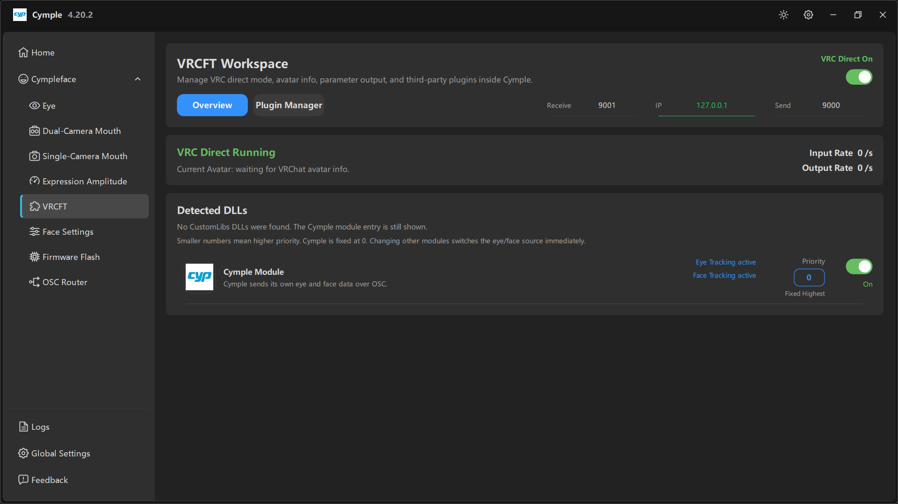

# VRCFT

Выходной каскад. Всё, что производят трекеры, приходит сюда и уходит либо напрямую в VRChat
(**VRC Direct**), либо через модуль VRCFaceTracking.

## Заголовок

**VRCFT Workspace** — *«Управляет режимом VRC Direct, информацией об аватаре, выводом параметров и
сторонними плагинами внутри Cymple.»*

Справа сверху: **VRC Direct On** (зелёная) с переключателем. Этот единственный переключатель
определяет весь путь доставки данных.

| VRC Direct | Поведение |
|---|---|
| **On** | Консоль сама отправляет параметры аватара в VRChat по OSC. Внешнее приложение не нужно. Пакеты совместимости для модуля VRCFT при этом **не** отправляются |
| **Off** | Консоль молчит в сторону VRChat и отдаёт только поток совместимости, который читает модуль Cymple для VRCFT. Этот режим нужен, когда интегратор — VRCFaceTracking |

Именно выключение прямого режима заставляет работать внешнюю связку с VRCFaceTracking — и это самая
частая причина, по которой модуль показывает «нет данных».

## Вкладки

| Вкладка | Содержимое |
|---|---|
| **Overview** | Порты, живые частоты, обнаруженные модули |
| **Plugin Manager** | Управление сторонними DLL, загружаемыми в рабочее пространство |

## Порты

| Поле | По умолчанию | Значение |
|---|---|---|
| **Receive** | `9001` | Порт, на котором консоль слушает OSC-вывод **VRChat**. Порт отправки VRChat по умолчанию |
| **IP** | `127.0.0.1` | Где запущен VRChat; для одного ПК верен loopback |
| **Send** | `9000` | Порт, на который консоль отправляет данные. Порт приёма VRChat по умолчанию |

У самого VRChat по умолчанию «приём 9000, отправка 9001», так что значения по умолчанию согласуются
с нетронутым VRChat. Если вы меняли OSC-порты VRChat, повторите их здесь — см.
[Порты и адреса](../reference/ports.md).

## VRC Direct Running

Карточка состояния с тремя живыми показателями:

| Показатель | Значение | Ожидание |
|---|---|---|
| **Current Avatar** | *"waiting for VRChat avatar info."*, пока VRChat ничего не сообщит | Имя аватара, как только вы окажетесь в мире |
| **Input Rate** | Параметров в секунду, полученных *от* VRChat | Ненулевое значение в VRChat, `0/s` в меню |
| **Output Rate** | Параметров в секунду, отправленных *в* VRChat | Должно следовать за входной частотой |

Таблица для диагностики:

| Вход | Выход | Значение |
|---|---|---|
| `0/s` | `0/s` | VRChat не запущен, OSC выключен в игре или неверные порты |
| `>0` | `0/s` | Приём идёт, отправки нет — модуль отключён или от трекеров нет данных |
| `>0` | `>0` | Всё работает |

Если **Input Rate** равен `0/s`, а VRChat запущен, проблема в связке VRChat → консоль, а не в
трекинге. Включите OSC в VRChat и проверьте параметр запуска на странице [OSC Router](osc-router.md).

## Detected DLLs

> *«Пользовательские DLL CustomLibs не найдены. Строка модуля Cymple при этом показывается.»*
> (*"No CustomLibs DLLs were found. The Cymple module entry is still shown."*)
>
> *«Меньшие числа означают более высокий приоритет. Cymple жёстко закреплён на 0. Смена приоритета
> других модулей сразу переключает источник взгляда и мимики.»*

Список показывает все модули, известные рабочему пространству, включая встроенный, даже когда
сторонние DLL не установлены.

В каждой строке есть:

| Элемент | Значение |
|---|---|
| Значок и имя модуля | например, **Cymple Module** |
| Описание | *«Cymple передаёт собственные данные взгляда и мимики по OSC.»* |
| **Eye Tracking active** / **Face Tracking active** | Какие области сейчас принадлежат этому модулю |
| Поле **Priority** | Числовой приоритет; для Cymple — **Fixed Highest** при `0` |
| Переключатель | Включает и выключает модуль |

### Правила приоритета

- Меньшее число — более высокий приоритет.
- **Cymple закреплён на `0`**, и его нельзя понизить: это встроенный источник.
- Сторонний модуль с большим числом уступает область Cymple; давайте ему приоритет, только если
  действительно хотите заменить данные взгляда или мимики Cymple.
- Смена приоритета действует сразу, перезапуск не нужен.

## Как выбрать путь

**Проще всего: VRC Direct**

1. Включите **VRC Direct**.
2. Оставьте порты `9001` / `127.0.0.1` / `9000`.
3. Включите OSC в VRChat.
4. Дождитесь, пока **Output Rate** станет ненулевым.

**Внешний VRCFaceTracking**

1. Выключите **VRC Direct**.
2. Установите `CympleFaceTracking.dll` через установщик пользовательских модулей VRCFaceTracking.
3. Запустите VRCFaceTracking до VRChat.
4. Параметры аватара настройте по инструкции [Внешний VRCFT](../guides/external-vrcft.md).

**Смешанные модули**

1. Оставьте **VRC Direct** включённым, если вам нужен собственный вывод Cymple.
2. Установите другие DLL и задайте их приоритет выше или ниже Cymple для каждой области.
3. Следите за метками **active** в строках, чтобы понимать, кто владеет взглядом и мимикой.

## Частые проблемы

| Симптом | Что делать |
|---|---|
| **VRC Direct On**, но вывод остаётся `0/s` | Нет данных от трекеров; проверьте предпросмотры и плашки на [Home](home.md) |
| Аватар так и не определился | OSC выключен в VRChat или входящий порт блокирует брандмауэр |
| Внешний модуль не получает данные | **VRC Direct** всё ещё включён — выключите его |
| Два источника борются за мимику | Настройте **Priority**; помните, что Cymple закреплён на 0 |

---

**Далее:** [Face Settings](face-settings.md) · [OSC Router](osc-router.md)

[English version](../../en/software/vrcft.md) · Русский · ИИ-перевод: DeepSeek-V4.1--Flash
